<div align="center">
  <p>
    <a href="https://github.com/luohuabuxiema/LabelPaw" target="_blank">
      </a>
  </p>
  <a href="README.md">English</a> | <a href="README_zh-CN.md">简体中文</a>
</div>


# LabelPaw - Intelligent Image Annotation and Model Training System (v3.0.0)
## Introduction
This project was created to meet the need for dataset annotation. After using tools such as labelme and labelimg, the author decided to combine excellent vision models including SAM2, SAM3, and YOLO pose estimation to develop a smarter and more efficient annotation tool. After multiple iterations, the system has reached the new **3.0.0 release**, which adds a one-click visual model training platform.

Source repository: [https://github.com/luohuabuxiema/LabelPaw](https://github.com/luohuabuxiema/LabelPaw)

## Changelog

- 2026-10-15: Upgraded to **v3.0.0**! Added the **one-click visual model training platform (TrainingPlatform)**, built with the modern MonkeyQt UI component library. It supports one-click YOLO model training, local hardware environment probing, real-time academic metric curve monitoring (Precision/Recall/mAP/Loss), hyperparameter tuning, and checkpoint resumption, forming an integrated workflow of “intelligent annotation + data conversion + model training.”
- 2026-05-28: Added SAM3 batch intelligent annotation and multiple-prompt annotation, added YOLO26 batch annotation, and optimized the file list with delete and multi-select buttons.
- 2026-05-27: Removed the class-selection window and unified class editing and creation in the history-class panel on the right. Added the ability to delete classes from the history and hide specified target boxes.
- 2026-05-15: Added keypoint skeleton templates for faces, hands, pedestrians, and other targets, with support for custom keypoint templates and connections.
- 2026-05-14: Added the SAM2.1 model for intelligent point-and-click annotation and integrated Ultralytics YOLO models. YOLO models can be used for intelligent rectangle, segmentation, keypoint, and OBB annotation.
- 2026-05-13: Improved JSON/XML/YOLO format conversion, added JSON-to-U-Net mask conversion, and added one-click random dataset splitting.
- 2026-05-10: Added Light and Dark theme modes for a more comfortable visual experience.
- 2026-04-12: Released the first basic intelligent annotation interface built with PySide6.
- 2026-04-10: Integrated the latest SAM3, supporting mouse-hover preview, fast single-point contour extraction, and automatic whole-image target segmentation from text prompts.
- 2026-04-9: Added rectangle (Rect), polygon (Poly), and point (Point) annotation, as well as the original OBB rotated-box control handles with smooth 360° rotation and wall-following sliding detection.
- 2026-04-8: Added native saving to JSON, YOLO (.txt), and XML (Pascal VOC).

<!-- Local revision note (2026-11-17): The following three items are locally implemented and verified feature changes based on the official project; they are not part of the original official README. -->
- **Local feature revisions**: Added number keys `0`–`9` for exact label-name selection in the annotation interface, right-click category deletion with synchronized annotation updates, and unified category colors between detection boxes and the right-side legend in the TrainingPlatform inference page.


## System Overview

Built with PySide6, the system integrates the **SAM2**, **SAM3**, and **Ultralytics YOLO** vision models to significantly improve annotation efficiency:
- **Intelligent point-and-click and prompt-based segmentation**: When SAM intelligent annotation is enabled, targets can be extracted quickly in polygon, rectangle, OBB, and other modes.
- **Keypoint skeleton templates and intelligent annotation**: The keypoint module includes pedestrian, hand, and face templates. You can customize keypoint templates for fast annotation, and optionally use YOLO models for intelligent keypoint detection and automatic connections.
- **One-click visual model training platform (TrainingPlatform)**: Built on the modern MonkeyQt component library, it integrates YOLO object detection, instance segmentation, and pose-estimation training. It provides one-click hardware probing, visual training-hyperparameter configuration, real-time academic-curve monitoring (Loss/Precision/Recall/mAP), and checkpoint resumption, connecting the workflow from data annotation to model training.

<!-- Local revision note (2026-11-17): Only the interface features that have been actually verified are added here; the official model and training logic is unchanged. -->
- **Local interface additions**: Number keys `0`–`9` select the class whose name exactly matches the pressed digit; right-clicking a category in the category list deletes it and synchronizes JSON/XML/YOLO annotations; inference-result detection-box colors in the training platform now match the right-side category legend.

| Feature | Interface Demo |
| ---------------- | ------------------------------------------------------------ |
| SAM3 batch annotation | 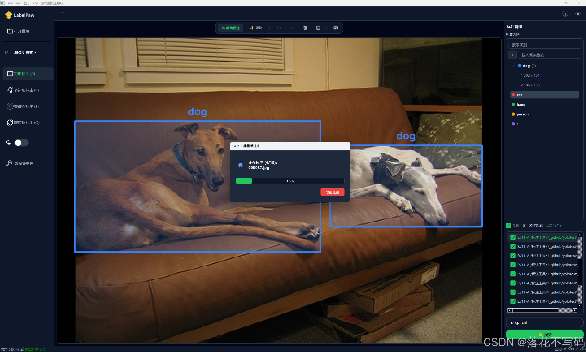 |
| YOLO model batch annotation | 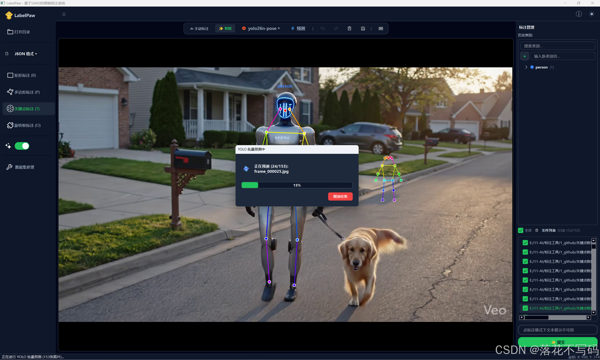 |
| Keypoint annotation | 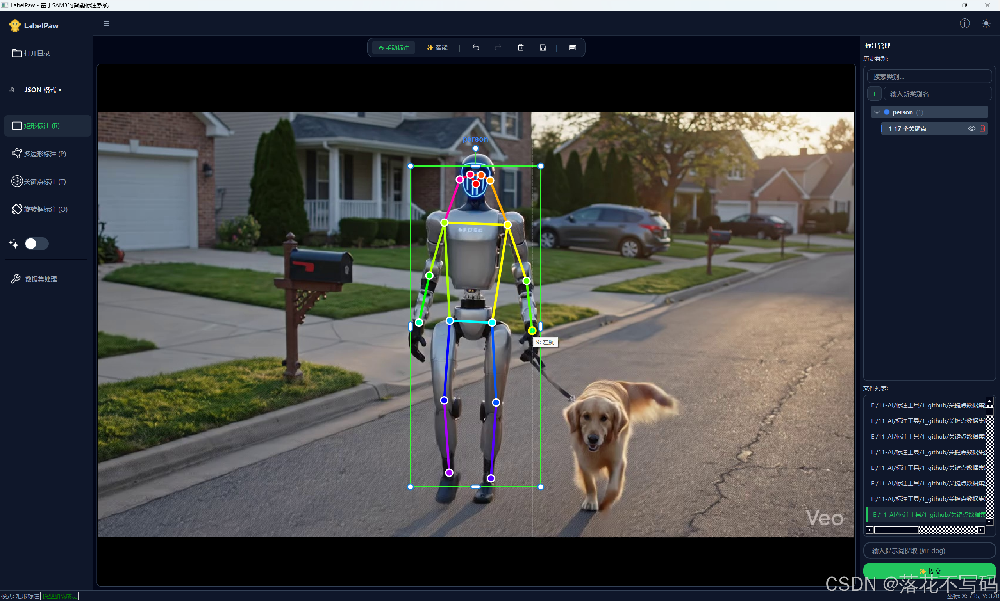 |
| OBB intelligent annotation | 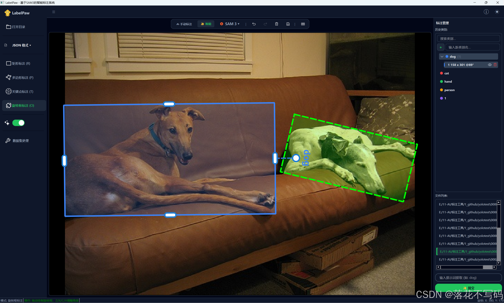 |
| Rectangle intelligent annotation | 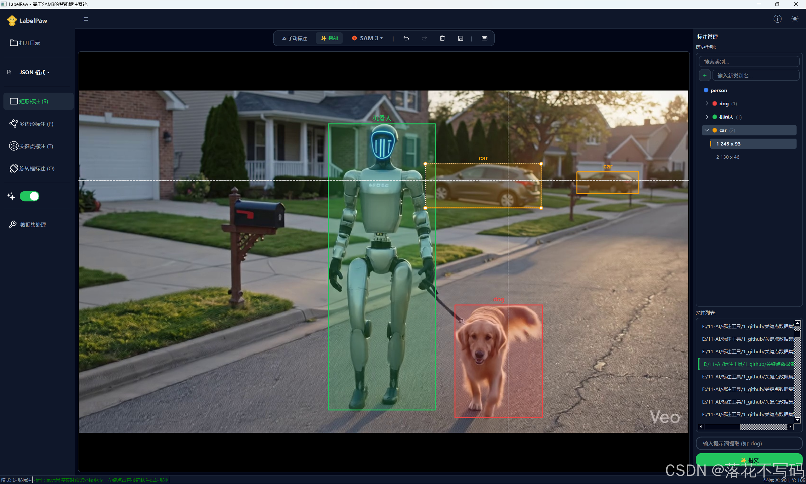 |
| Intelligent keypoint annotation | 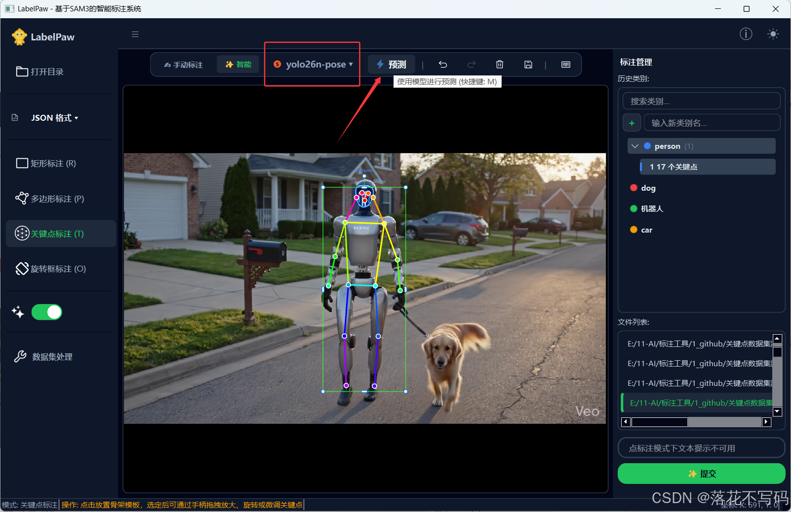 |
| Hand keypoint template (Dark) | 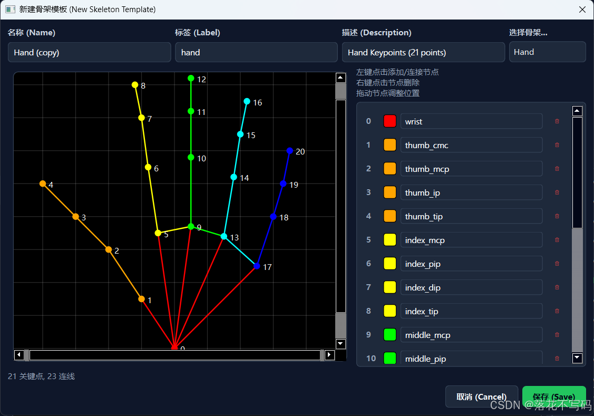 |
| Built-in keypoint templates | 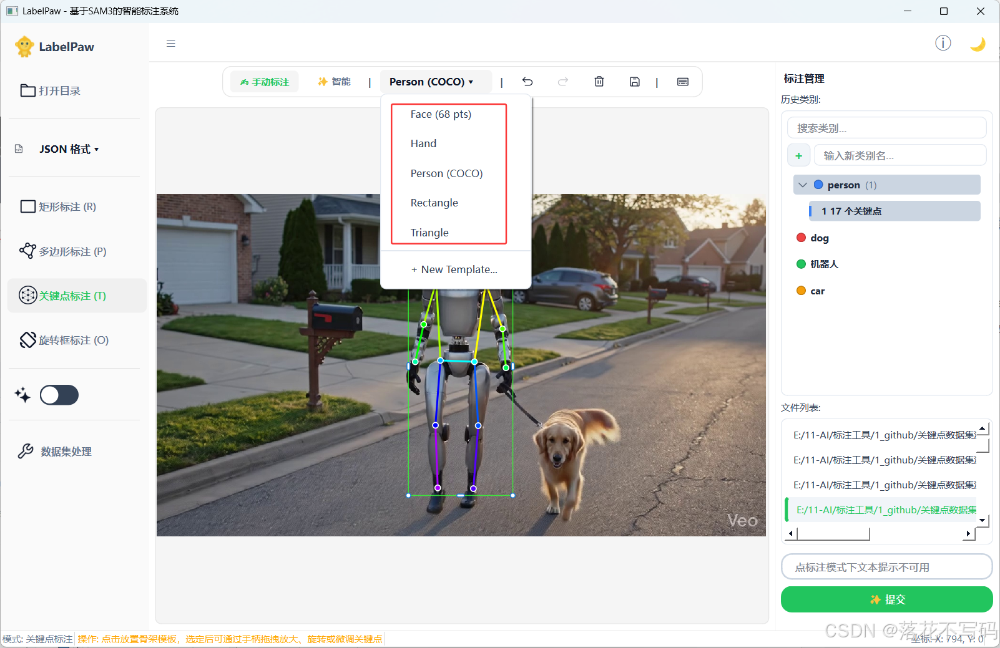 |
| Face keypoint template | 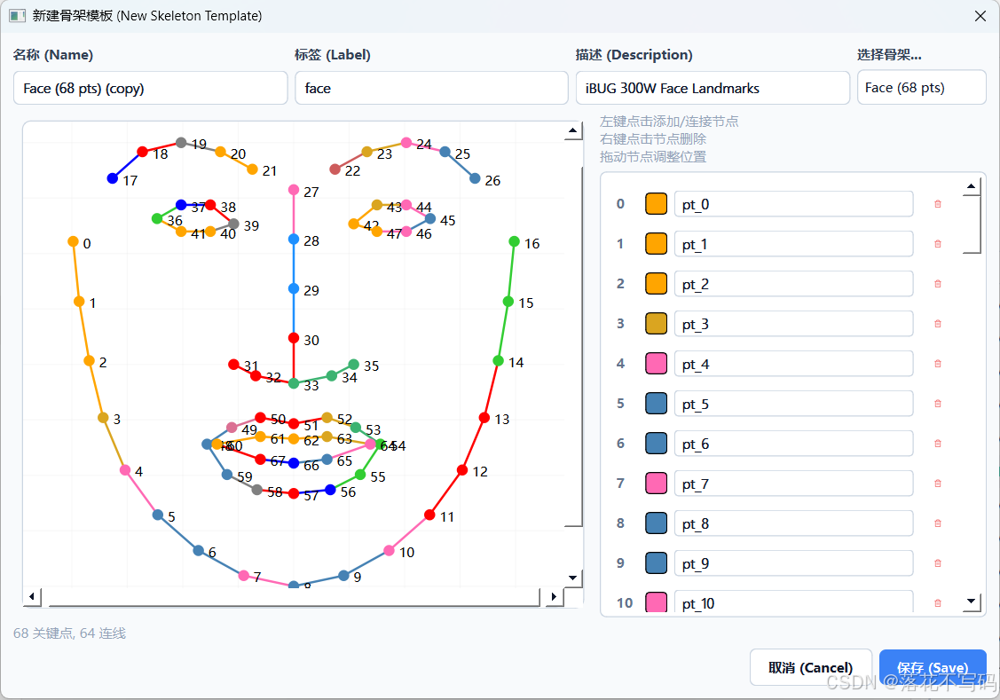 |
| Hand keypoint template (Light) | 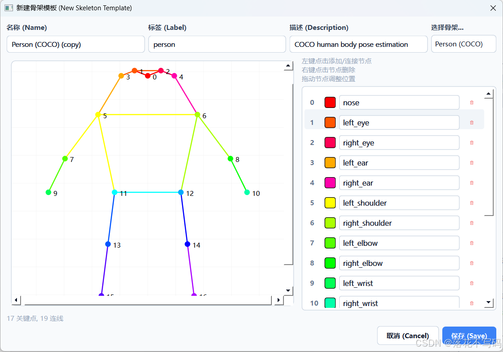 |
| Custom keypoint template | 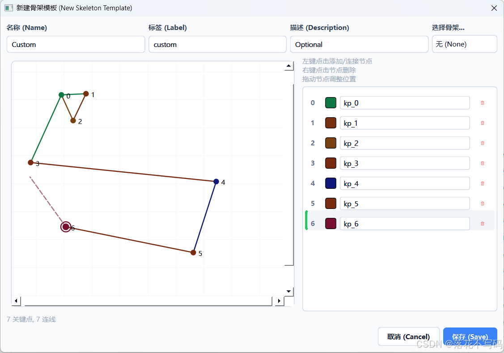 |
| Dataset processing tools | 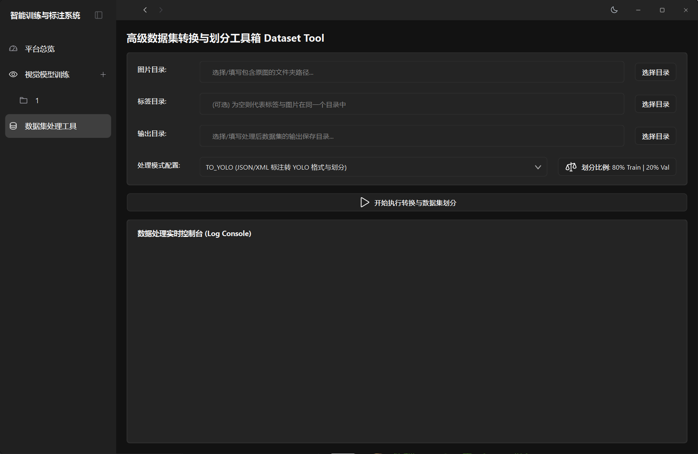 |
| Training platform overview and hardware monitoring | 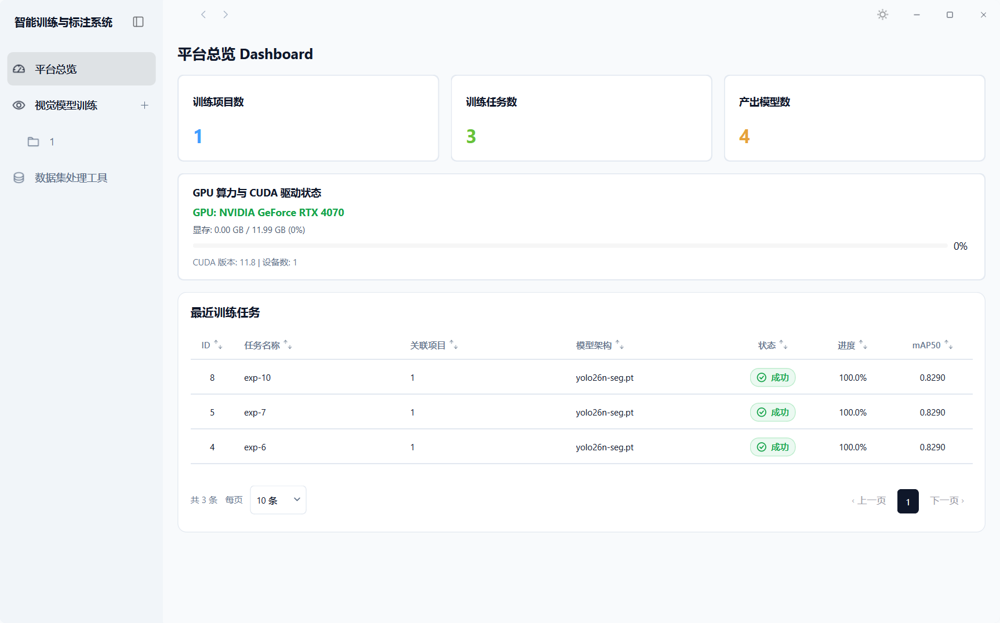 |
| Project training metrics and model comparison | 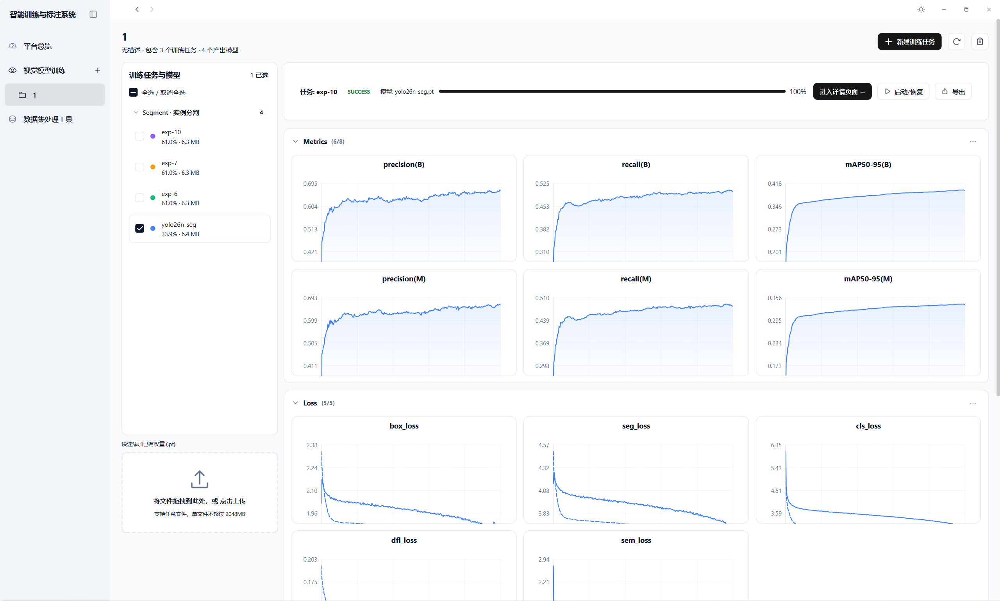 |
| Create training task and environment probe | 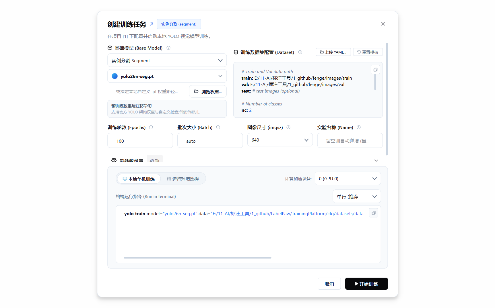 |
| Experiment convergence curves and academic charts | 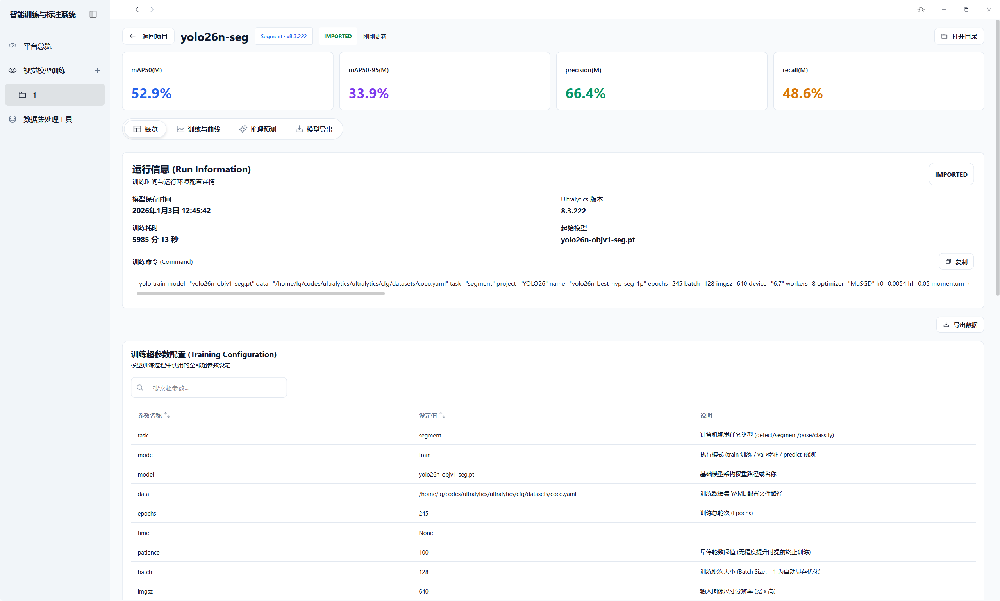 |


## 🙊 Core Features

- **✨ AI intelligent assistance (SAM2/SAM3 powered)**: Mouse-hover preview, fast single-point contour extraction, and automatic whole-image target segmentation from text prompts.
- **🦴 Keypoint skeleton templates and intelligent annotation (YOLO powered)**: Supports intelligent rectangle, segmentation, OBB, and keypoint annotation. Built-in keypoint templates include pedestrians (17 keypoints), faces (68 keypoints), and hands (21 keypoints). Keypoint annotation supports custom skeleton templates.
- **🚀 One-click visual model training**: Includes the integrated TrainingPlatform, supporting rapid training of YOLO object detection, instance segmentation, pose-estimation, and other models, with academic multi-curve comparison dashboards, real-time hardware monitoring, and task management.
- **📐 Full annotation modes**: Rectangle (Rect), polygon (Poly), point (Point), OBB rotated box, and keypoint (Pose).
- **🔄 Advanced OBB interaction**: Rotated-box control handles with smooth 360° rotation and wall-following sliding detection.
- **💾 Multi-format conversion and export**: Native JSON, YOLO (.txt), and XML (Pascal VOC) saving, with one-click U-Net mask generation.
- **🗄️ Dataset processing workflow**: Supports splitting datasets into training, validation, and test sets according to a specified ratio.

---

## 🛠️ Deployment and Runtime Environment

### 1. Basic Environment Dependencies

<!-- Revision note (2026-11-17): The locally verified environment is Linux, the Conda environment yolo, and Python 3.11. This does not mean that other platforms have been verified. -->
The environment verified in this setup is Linux, the Conda environment `yolo`, and Python 3.11.

Create the virtual environment:

```bash
conda create -n yolo python=3.11
```
Activate the virtual environment:

```bash
conda activate yolo
```

<!-- Revision note: Replaced the original Windows/CUDA general instructions and several unverified installation commands with the Conda command actually executed in this setup. -->
The PyTorch/CUDA installation command actually executed in this setup is:
```bash
conda install pytorch==2.5.0 torchvision==0.20.0 torchaudio==2.5.0 pytorch-cuda=11.8 -c pytorch -c nvidia
```

To check whether Python can import PyTorch, activate the `yolo` environment and run `python -c "import torch; print(torch.__version__)"`. In this setup, the Conda package list was confirmed to contain PyTorch 2.5.0, TorchVision 0.20.0, TorchAudio 2.5.0, and `pytorch-cuda` 11.8. This does not claim that CUDA inference or training has been verified here.

---


Then install the project dependencies in the `yolo` environment:

```bash
pip install -r requirements.txt
```
<!-- Local revision note: Removed the dependency list in the original README because it did not match requirements.txt; requirements are now maintained in one place. The original numpy~=1.24.4 was changed to numpy~=1.26.4, and the original ftfy~=6.3.1 was changed to ftfy==6.1.1. The former satisfies SAM3's numpy>=1.26,<2 requirement, and the latter satisfies SAM3's ftfy==6.1.1 requirement. Both were successfully installed with requirements.txt. -->
The dependency list is maintained in the project-root `requirements.txt`. Do not copy a separate version list from the README.

<!-- Local revision note: requirements.txt already contains installation entries for SAM2, SAM3, and Ultralytics. Normally run pip install -r requirements.txt directly. Source-copy or git+ installation is a fallback; do not install multiple sets of versions without first confirming their import sources. -->
The current `requirements.txt` contains:

```text
git+https://github.com/facebookresearch/sam3.git
git+https://github.com/facebookresearch/sam2.git
ultralytics==8.4.49
```

<!-- Revision note: Replaced the original statement that installing the PyPI monkeyqt package alone was sufficient. Although that package can be installed, the project was missing required APIs at runtime. The following procedure comes from the locally successful startup process. -->
**MonkeyQt compatibility handling (verified locally)**: Installing only the PyPI `monkeyqt` package from `requirements.txt` left required APIs missing at runtime. In this setup, the MonkeyQt source was cloned to `/tmp/MonkeyQt-source` and installed in editable mode, and the old `site-packages/monkeyqt` directory in the environment was then renamed. After this, the LabelPaw interface started successfully. Activate `yolo` and run:

```bash
git clone https://github.com/luohuabuxiema/MonkeyQt.git /tmp/MonkeyQt-source
pip install -e /tmp/MonkeyQt-source
mv /home/cjr/miniconda3/envs/yolo/lib/python3.11/site-packages/monkeyqt /home/cjr/miniconda3/envs/yolo/lib/python3.11/site-packages/monkeyqt-old
```

If `/tmp/MonkeyQt-source` already exists, skip `git clone`. If `monkeyqt-old` already exists or `monkeyqt` no longer exists, do not run `mv` again.

Verify the MonkeyQt import path and project modules:

```bash
python -c "import monkeyqt; print(monkeyqt.__file__); from monkeyqt.themes.engine import ThemeEngine; from monkeyqt import MkMessageBox, MkSkeleton, MkSkeletonBlock, MkChartDashboard; print('MonkeyQt API 正常')"
cd ~/下载/LabelPaw
python -c "from TrainingPlatform.ui.main_window import MainWindow; print('训练平台导入正常')"
python main.py
```

The paths above correspond to the local Conda installation. On another machine, first confirm and replace the path with that machine's `site-packages` path. This section only records the old-directory shadowing procedure that successfully worked locally; it is not a claim that a general installation procedure has been verified.
> - **MonkeyQt component-library documentation**: [https://monkeyqt.lhbxm.top/](https://monkeyqt.lhbxm.top/)
> - **Official MonkeyQt source repository**: [https://github.com/luohuabuxiema/MonkeyQt](https://github.com/luohuabuxiema/MonkeyQt)

> Note: If you need intelligent assistance, make sure that the `sam3`, `sam2`, and `ultralytics` libraries and their dependencies are correctly configured. If installation of the SAM3, SAM2, or Ultralytics libraries above fails, the source-installation tutorial below is also available.

#### Errors Encountered During Installation

(1) The virtual environment could not be created:
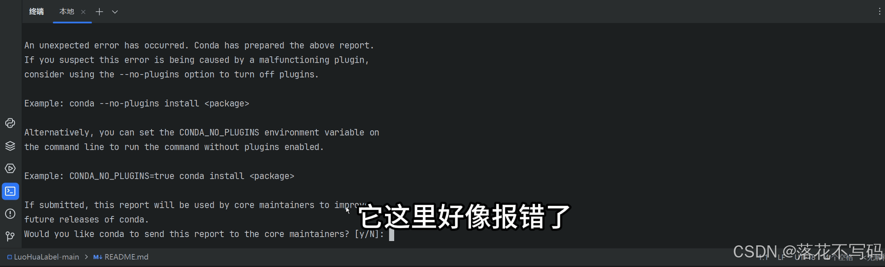

Solution: Go to `C:\Users\你的用户` and delete the `.condarc` file.

(2) Error: `ModuleNotFoundError: No module named ‘pkg_resources‘`

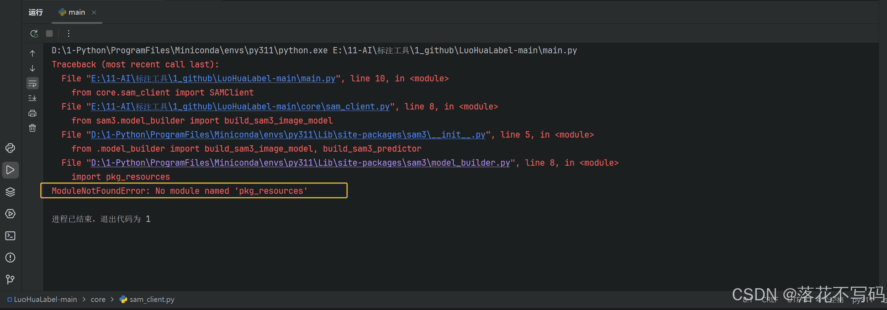

Solution: Downgrade the `setuptools` package. The version installed in this setup was 79.0.1.

```python
pip install setuptools==79.0.1
```
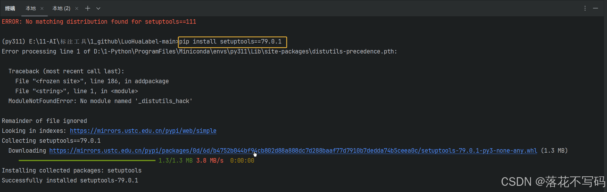

Reference: [https://blog.csdn.net/u014451778/article/details/158469881](https://blog.csdn.net/u014451778/article/details/158469881/)

(3) Error: `ModuleNotFoundError: No module named ‘triton‘`
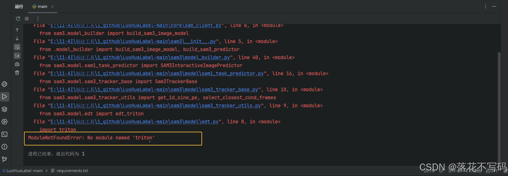

Solution: Download an offline installation package and install it separately.

Triton offline package download: [https://hf-mirror.com/madbuda/triton-windows-builds](https://hf-mirror.com/madbuda/triton-windows-builds/)

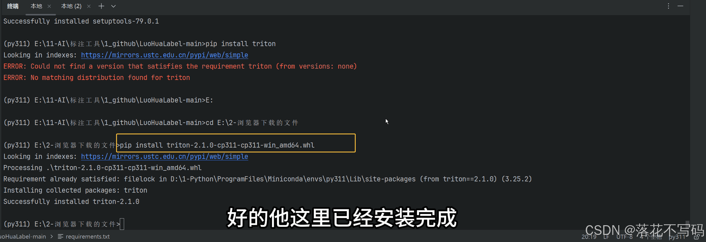

Reference: [https://blog.csdn.net/qq_42910179/article/details/155606159](https://blog.csdn.net/qq_42910179/article/details/155606159/)

### 2. Optional Fallback Source Installation for SAM2, SAM3, and Ultralytics

`requirements.txt` already contains installation entries for SAM2, SAM3, and Ultralytics. Normally, you do not need to repeat this section. Use the source-installation method only if dependency installation fails or if you explicitly want to use local source code; do not install two sets of versions at the same time.

**Official source repositories**:

- **SAM2**: [https://github.com/facebookresearch/sam2](https://github.com/facebookresearch/sam2)
- **SAM3**: [https://github.com/facebookresearch/sam3](https://github.com/facebookresearch/sam3)
- **Ultralytics (YOLO)**: [https://github.com/ultralytics/ultralytics](https://github.com/ultralytics/ultralytics)

**Steps for local source installation**:

1. Visit the GitHub addresses above, click the green **Code** button, and select **Download ZIP**.
2. Extract the downloaded archive.
3. **Important**: The archive often contains documentation, tests, and many other files. Only use the **core code folders** inside the extracted archive; they are the folders named `sam2`, `sam3`, and `ultralytics`.
4. Paste these three folders (`sam2`, `sam3`, and `ultralytics`) directly into the root directory of `LabelPaw`.

**Direct command-line installation (choose this or the copy method above)**:
If you do not want to download and copy the folders manually, install the source code directly from GitHub with pip:

```bash
# Install SAM2
pip install git+https://github.com/facebookresearch/sam2.git

# Install SAM3
pip install git+https://github.com/facebookresearch/sam3.git

# Install Ultralytics
pip install ultralytics==8.4.49
```

> ⚠️ **Notes on the `git+` installation method**:
> 1. **Git is required**: Git must be installed and configured on your computer in advance; otherwise, the command will fail directly.
> 2. **Network access to GitHub**: Because GitHub access can be unstable in some regions of China, using `git+https://...` may result in a timeout or connection failure. Users in China are advised to:
>    - Enable a suitable network connection and temporarily configure a Git proxy in the command line.
>    - Or preferably use the official source-download-and-extract method above, which is more reliable.

### 3. Model Download and Configuration Changes

**Model download and storage**:

To enable intelligent annotation, download the required weight files (`.pt`) and organize them according to the directory structure below.

**1. Recommended model directory structure**
It is recommended to organize local model files as follows:
```text
 weights/
      ├── sam_weights/          <-- Store all SAM-series models (this name is required)
      │    ├── sam3.pt
      │    ├── sam2.1_hiera_tiny.pt
      │    └── ...
      ├── yolo26_weights/       <-- Store YOLO26-series models
      │    ├── yolo26n-pose.pt
      │    └── ...
      ├── yolov8_weights/       <-- You may also create folders for other YOLO versions
      │    ├── yolov8n.pt
      │    └── ...
      └── ...
```

**2. SAM model download and storage**

- **SAM 3 model (3.5 GB)**: Visit the official GitHub repository or search Hugging Face for `sam3`. Store it at `\weights\sam_weights\sam3.pt`.
- **SAM 2.1 models**:
  - SAM 2.1 Tiny: [https://dl.fbaipublicfiles.com/segment_anything_2/092824/sam2.1_hiera_tiny.pt](https://dl.fbaipublicfiles.com/segment_anything_2/092824/sam2.1_hiera_tiny.pt)
  - SAM 2.1 Small: [https://dl.fbaipublicfiles.com/segment_anything_2/092824/sam2.1_hiera_small.pt](https://dl.fbaipublicfiles.com/segment_anything_2/092824/sam2.1_hiera_small.pt)
  - SAM 2.1 Base: [https://dl.fbaipublicfiles.com/segment_anything_2/092824/sam2.1_hiera_base_plus.pt](https://dl.fbaipublicfiles.com/segment_anything_2/092824/sam2.1_hiera_base_plus.pt)
  - SAM 2.1 Large: [https://dl.fbaipublicfiles.com/segment_anything_2/092824/sam2.1_hiera_large.pt](https://dl.fbaipublicfiles.com/segment_anything_2/092824/sam2.1_hiera_large.pt)
  - Storage location: the `\weights\sam_weights\` directory (keep the default filenames).

**3. YOLO model download and storage**
- **YOLO models**: Visit the official YOLO GitHub repository or the corresponding framework page to download the latest weights, such as yolov8, yolo11, or yolo26. For pose estimation, models with the `-pose` suffix are recommended, such as `yolo26n-pose.pt`.
- **Storage location**: Store models in the corresponding folder, such as `\weights\yolo26_weights\`. *(Note: You can also put your own trained YOLO models in the corresponding folder, and the software can read them automatically.)*

**Changing the model path**:
To allow the system to find the downloaded models:

> Method 1: Create a `weights` folder in the project root and store the models there according to the structure described above.

> Method 2: Create a `weights` folder elsewhere and store the models there according to the structure described above. **Only** one base-path variable in the code needs to be changed:
Open `main.py`, `labelpaw/models/sam_client.py`, and `ui/model_selector_dialog.py`. Find the `HARDCODED_DEV_DIR` variable and change it consistently to the absolute path of your local `weights` folder: **HARDCODED_DEV_DIR= r"你的绝对路径\weights"**


*(Note: The system automatically scans all subfolders matching `yolo*_weights` under this directory and loads the YOLO models, so you only need to place the models correctly and do not need to manually specify the YOLO subdirectory.)*

**[Special note for users without a graphics card (GPU)]**
If your computer does not have a dedicated GPU or has relatively low specifications, it is strongly recommended to use YOLO models first, such as lightweight models containing “n” or “s”. Even the tiny SAM models are relatively heavy; running them on a CPU-only system may be very slow or cause the software to become unresponsive, while lightweight YOLO models can still provide reasonable processing speed on a CPU.

### 4. Starting the System

After completing all configuration, start the system from the project root as needed:

- **Main system (integrated entry point for intelligent image annotation and the training platform)**:
```bash
python main.py
```
*(The model training platform can be launched with one click from the left toolbar of the annotation interface.)*

- **Run the one-click training platform independently (TrainingPlatform)**:
```bash
python TrainingPlatform/main_app.py
```

---

## 📖 User Guide

### 1. Intelligent Image Annotation Workflow (LabelPaw)

#### 📋 Basic Annotation Workflow
1. **Open a directory**: Click the **“Open Directory”** button on the left and select the folder containing the images.
2. **Select the save format**: Select a format from the left dropdown menu (`JSON` / `YOLO` / `XML` are supported).
3. **Select the annotation mode**: Select an annotation mode from the left toolbar. Rectangle, polygon, point, OBB rotated box, and keypoint skeleton modes are supported.
4. **Intelligent assisted annotation**: Enable **“Intelligent Assistance”** with the shortcut `Q`.
   - **SAM2 / SAM3 models**: Support real-time contour preview on mouse hover and fast single-point target-boundary extraction. SAM3 supports entering text prompts such as "car" or "dog" for whole-image automatic segmentation.
   - **YOLO models**: Use the top toolbar to switch models and perform automatic preliminary inference for object detection, segmentation, rotated boxes, and pose estimation.
5. **Keypoint/skeleton templates**: In keypoint mode, select built-in templates from the top bar (17-point human body, 68-point face, or 21-point hand), or customize keypoint template connections.
6. **Dataset processing**: Click **“Dataset Conversion”** in the toolbar to convert between JSON/XML/YOLO formats, generate U-Net binary masks, and randomly split the dataset into training, validation, and test sets according to a custom ratio.

#### ⌨️ Annotation Shortcut Reference

| Shortcut | Function | Shortcut | Function |
| :--- | :--- | :--- | :--- |
| **A / ←** | Switch to the previous image | **D / →** | Switch to the next image |
| **Ctrl + S** | Manually save the current image annotation | **Q** | Enable / disable SAM intelligent assistance |
| **R** | Switch to rectangle annotation mode (Rect) | **P** | Switch to polygon annotation mode (Poly) |
| **O** | Switch to rotated-box annotation mode (OBB) | **T** | Switch to keypoint annotation mode (Pose) |
| **M** | Trigger YOLO model intelligent inference | **E** | Quickly change the class of the currently selected target |
| **Del / Backspace** | Delete the currently selected annotation target | **Ctrl + Z** | Undo the previous operation (supports 20 steps) |
| **Ctrl + Y** | Redo the operation (Ctrl+Shift+Z) | **Z / X / C / V** | Fine angle adjustment for OBB rotated boxes |

<!-- Local revision note (2026-11-17): Number-key shortcuts use exact label-name matching rather than mapping to the order of the class list. -->
| **0–9** | Select the class whose name exactly matches the pressed digit; for example, press `2` to select the label `2` |  |  |

<!-- Local revision note (2026-11-17): Added right-click category deletion; deletion modifies the current dataset annotation files. -->
#### Additional Category Management

Right-click a category in the category list on the right, select **“Delete Category”**, and confirm. The program will:

- Delete annotation objects belonging to that category from the current canvas;
- Remove the category from the current category list;
- Delete the corresponding category objects from JSON/XML annotation files;
- Delete rows for that category from the YOLO `.txt` file and decrement subsequent class IDs by one;
- Update the category file, category tree, and current canvas, then save automatically.

This operation modifies the current dataset files. Back up the images and annotation files before performing it on an official dataset.

---

### 2. One-Click Visual Model Training Platform Tutorial (TrainingPlatform)

The one-click training platform (TrainingPlatform) is built on the modern MonkeyQt UI component library. It is designed to help users complete the full deep-learning vision-model workflow—including one-click training, real-time monitoring, and export—without writing complex code.

#### 🛠️ 2.1 Preparation Before Training

Before starting training, make sure the following preparation is complete:

##### 1. Dataset Preparation and Standard Directory Structure
After completing annotation with LabelPaw, use the **“Dataset Conversion”** function in the toolbar to export and split the annotations into a standard YOLO-format directory:
```text
my_dataset/
├── images/
│   ├── train/          <-- Training images (.jpg, .png, etc.)
│   ├── val/            <-- Validation images
│   └── test/           <-- Test images (optional)
└── labels/
    ├── train/          <-- Corresponding training annotation files (.txt)
    ├── val/            <-- Corresponding validation annotation files (.txt)
    └── test/           <-- Corresponding test annotation files (optional)
```

##### 2. Create/Configure the `data.yaml` File
Create `data.yaml` in the dataset root directory. The platform includes an online editor that can load and modify it directly.

- **Standard tasks (object detection / instance segmentation / rotated-box OBB)**:
```yaml
# Training and validation paths (absolute paths or paths relative to the project root are supported)
train: D:/datasets/my_dataset/images/train
val: D:/datasets/my_dataset/images/val
test: # D:/datasets/my_dataset/images/test (optional)

# Number of classes
nc: 2

# Class-name mapping
names:
  0: dog
  1: cat
```

- **Keypoint / pose-estimation tasks (Pose)**:
```yaml
train: D:/datasets/my_pose_dataset/images/train
val: D:/datasets/my_pose_dataset/images/val

nc: 1
names:
  0: person

# Keypoint dimensions: [number of keypoints, coordinate dimensions (x, y, visible)]
kpt_shape: [17, 3]
# Symmetric keypoint index mapping for horizontal-flip augmentation
flip_idx: [0, 2, 1, 4, 3, 6, 5, 8, 7, 10, 9, 12, 11, 14, 13, 16, 15]
```

##### 3. Prepare a Basic Pretrained Model
- The platform supports YOLOv8, YOLO11, YOLO26, and other model series.
- You may use official pretrained weights such as `yolov8n.pt`, `yolo11s.pt`, `yolo26n-seg.pt`, and `yolo26n-pose.pt`. If they have not been downloaded locally, they will be downloaded automatically when training starts; alternatively, place them locally and click **“Browse”** in the platform to select them.

##### 4. Hardware Requirements
- **Dedicated GPU (recommended)**: Use an NVIDIA GPU and install a CUDA-supported PyTorch version. The platform includes an **environment probe** that automatically detects the GPU model, VRAM size (for example, RTX 4090 24GB), and CUDA status at startup.
- **Users without a GPU**: The platform supports **CPU training**. A lightweight model such as `yolov8n` or `yolo11n` is recommended, together with a small `batch` value.

---

#### 🚀 2.2 Detailed Training Steps

##### Step 1: Start the Training Platform
- **Integrated entry point**: Start LabelPaw (`python main.py`), then click the **“Model Training”** icon in the left navigation bar of the main interface.
- **Independent entry point**: Run `python TrainingPlatform/main_app.py` directly in a terminal.

##### Step 2: Create or Select a Training Project
1. On first entry, open the **“Project Management”** page from the left navigation.
2. Click **“New Project”** in the upper-right corner, enter a project name such as `Road_Defect_Inspection`, select a vision task type (object detection Detect / instance segmentation Segment / pose estimation Pose / rotated-box OBB), and confirm.
3. Click to enter the details page of the created project.

##### Step 3: Configure Training Task Hyperparameters (Train Configuration)
Click **“New Training Task”** in the upper-right corner of the project details page. The system opens a full parameter-configuration window:

1. **Basic configuration (model and data)**:
   - **Base model**: Select a built-in preset model such as YOLOv8n or YOLO11s, or click the folder icon to load a local custom `.pt` weight file.
   - **Dataset configuration**: Click **“Select Dataset”** and choose the prepared `data.yaml`. The YAML content is automatically loaded on the right side of the window and can be edited and saved online.
2. **Core training hyperparameters**:
   - **Epochs**: Set this according to the dataset size; `100`–`300` epochs are usually recommended.
   - **Batch Size**: Enter `auto` for the platform to detect the optimal batch size based on the current VRAM, or manually enter a fixed value such as `8`, `16`, or `32`.
   - **Image Size (ImgSz)**: The default is `640`; use `1280` when there are many small objects or when high-resolution images are needed.
   - **Experiment name**: Name the training run, such as `exp1_baseline`.
3. **Advanced hyperparameter tuning (collapsible panel)**:
   - **Optimizer and learning rate**: Supports `auto`, `SGD`, `Adam`, and `AdamW`. You can configure the initial learning rate `lr0` (default `0.01`), cosine learning-rate decay `cos_lr`, and the number of learning-rate warmup epochs `warmup_epochs`.
   - **Acceleration and training strategies**:
     - **Automatic mixed precision (AMP)**: Enabled by default to substantially reduce VRAM usage and improve training speed;
     - **Early stopping (Patience)**: Automatically stops when the metrics do not improve for N consecutive epochs (default `100`);
     - **Close Mosaic**: Automatically disables Mosaic augmentation for the final N epochs to stabilize convergence (default `10`);
     - **Resume**: If training was interrupted, select this option and specify `last.pt` to resume training seamlessly.
   - **Data augmentation controls**: Mosaic, Mixup, HSV jitter, rotation (Degrees), and horizontal/vertical flip ratios can be adjusted.
4. **Hardware and training-device probe**:
   - The training-device selector at the bottom automatically detects available GPUs, such as `0: NVIDIA GeForce RTX 4090`. Select the target GPU number and specify the number of data-loading workers (`workers`, with 4 or 8 recommended).

##### Step 4: Start Training and Monitor It in Real Time
1. After confirming that the parameters are correct, click **“Start Training”** in the lower-right corner of the window.
2. The task runs in the background and the interface switches to the **“Real-Time Monitoring”** dashboard:
   - **Academic multi-metric convergence curves**: Dynamically draw the metrics for the current epoch:
     - **Loss curves**: `train/box_loss`, `train/cls_loss`, `train/dfl_loss`, and validation loss;
     - **Academic evaluation metrics**: `metrics/precision(B)`, `metrics/recall(B)`, `metrics/mAP50(B)`, and `metrics/mAP50-95(B)`;
     - Supports switching curve-smoothing filters, focusing on a single curve, and comparing multiple experiments.
   - **Formatted log console**: Displays the training progress bar, VRAM usage, estimated time, and learning rate in real time.
   - **Hardware probe monitoring cards**: Dynamically display VRAM usage, GPU utilization, and system CPU load.

##### Step 5: Evaluate the Experiment and Export the Model
1. After training completes, the platform automatically summarizes the academic charts for the training run:
   - Confusion matrix (`confusion_matrix.png`);
   - PR curve (`PR_curve.png`) and F1-Confidence curve;
   - Comparison between validation-set ground-truth annotations and model predictions (`val_batch_pred.jpg`).
2. **Automatic weight-file archiving**:
   - `best.pt`: The best model weights with the highest validation-set metrics;
   - `last.pt`: The checkpoint from the final epoch, used for resuming training.
3. **Industrial model export**:
   - Click **“Model Export”** on the experiment details page to convert `best.pt` to **ONNX**, **TensorRT (Engine)**, **TorchScript**, and other formats for high-performance deployment on edge devices or in production environments.

<!-- Local revision note (2026-11-17): This only documents the display correction on the inference page; model weights, detection results, and the training workflow are unchanged. -->
4. **Consistent colors in the inference page**:
   - Detection boxes in the image and the **“Detected Objects”** legend on the right now use the same class-color mapping;
   - Multiple detected objects of the same class use the same color;
   - This change affects only the interface display. It does not change model weights, detection-box coordinates, class names, confidence values, or training logic;
   - After modifying the code, restart LabelPaw and re-enter the **“Inference”** page to upload an image before checking the effect.

---

#### 🔄 2.3 Seamless “Annotation–Training” Workflow

In LabelPaw, annotation and training are not two separate tools; they form a closely integrated workflow:
```text
┌─────────────────┐      Dataset export (YOLO format)     ┌──────────────────────┐
│  LabelPaw       │ ───────────────────────────────────> │  TrainingPlatform    │
│  Intelligent    │                                      │  One-click visual    │
│  image annotation│                                     │  model training      │
└─────────────────┘                                      └──────────────────────┘
        ▲                                                        │
        │           Import generated best.pt weights              │
        └────────────────────────────────────────────────────────┘
```
1. Annotate a small number of samples (for example, 100–200 images) with LabelPaw and export the dataset;
2. Train with one click in TrainingPlatform to produce a `best.pt` for your own scenario;
3. Put `best.pt` in LabelPaw's `weights/` directory;
4. Return to the LabelPaw annotation interface, select this model at the top, and enable **Intelligent Assistance**. The trained model can then perform **fully automatic batch pre-annotation** on thousands of subsequent images, improving annotation efficiency by more than 10 times.

---

#### 💡 2.4 Training FAQ and Tuning Tips

- **Q1: Training reports insufficient VRAM (CUDA Out of Memory / OOM). What should I do?**
  - **Solution**:
    1. Reduce the `Batch Size` when creating the task, for example from 32 to 16, 8, or 4;
    2. Reduce the `ImgSz`, for example from 1280 to 640 or 480;
    3. Confirm that `AMP (automatic mixed precision)` is enabled in the advanced settings;
    4. Reduce the number of `workers` to 2 or 4.
- **Q2: Can I train without a dedicated GPU?**
  - **Solution**: Yes. Select `CPU` as the training device, use a lightweight `yolov8n` model, set `batch` to 4, and use a small number of `epochs` for an initial check.
- **Q3: How can I resume after an unexpected interruption?**
  - **Solution**: Open the new training task window, enable **“Resume”** in the advanced settings, select the `last.pt` weight file from the interrupted experiment in the base-model path, and click Start Training. Training will continue from the interrupted epoch.

---

## 🤝 Contributing and Further Development

The system uses a modular design with high cohesion and low coupling, separating the frontend UI from the underlying model inference.
- `main.py`: Main interface and event routing.
- `labelpaw/`: Core image-annotation modules, including the drawing canvas (`graphics/canvas.py`), data-format export (`data/exporter.py`), SAM intelligent-model inference (`models/sam_client.py`), and YOLO intelligent-model inference (`models/yolo_predictor.py`).
- `TrainingPlatform/`: One-click visual model training platform module built with the MonkeyQt component library, including the training-task scheduler (`core/`), modern UI views, and academic charts (`ui/`).
- `ui/`: Graphical components and theme customization.

Developers are welcome to fork the project and submit pull requests!

## License

This project is licensed under GPL-3.0. If you use this code in a commercial or non-commercial project, please comply with the license and open-source your derivative modifications as required. Thank you for your support; if this project helps you, please give the repository a Star!

## Citation

If you use this software in your research, please cite it as follows:

```bibtex
@misc{LabelPaw,
  year = {2026},
  author = {luohuabuxiema},
  publisher = {Github},
  journal = {Github repository},
  title = {LabelPaw: Intelligent image annotation system},
  howpublished = {\url{https://github.com/luohuabuxiema/LabelPaw}}
}
```

**Acknowledgements and reference model citations**:

```bibtex
@misc{carion2025sam3segmentconcepts,
      title={SAM 3: Segment Anything with Concepts},
      author={Nicolas Carion et al.},
      year={2025},
      eprint={2511.16719},
      archivePrefix={arXiv},
      primaryClass={cs.CV},
      url={https://arxiv.org/abs/2511.16719},
}

@article{ravi2024sam2,
  title={SAM 2: Segment Anything in Images and Videos},
  author={Ravi, Nikhila and Gabeur, Valentin and Hu, Yuan-Ting and Hu, Ronghang and Ryali, Chaitanya and Ma, Tengyu and Khedr, Haitham and R{\"a}dle, Roman and Rolland, Chloe and Gustafson, Laura and others},
  journal={arXiv preprint arXiv:2408.00714},
  year={2024}
}

@software{ultralytics,
  author = {Glenn Jocher and Ayush Chaurasia and Jing Qiu},
  title = {Ultralytics},
  year = {2023},
  url = {https://github.com/ultralytics/ultralytics},
  license = {AGPL-3.0}
}
```
