<div align="center">
  <p>
    <a href="https://github.com/luohuabuxiema/LabelPaw" target="_blank">
      </a>
  </p>
  <a href="README.md">English</a> | <a href="README_zh-CN.md">简体中文</a>
</div>


# LabelPaw - 智能图像标注与模型训练系统 (v3.0.0)
## 前言
由于项目需要标注数据集，之前用过 labelme、labelimg 等工具，于是决定结合 SAM2、SAM3、YOLO 姿态估计等优秀的视觉模型，开发一个更智能、更高效的标注工具。经过多次迭代，系统迎来了全新的 **3.0.0 版本**（新增一键式视觉模型训练平台）！

源码地址：[https://github.com/luohuabuxiema/LabelPaw](https://github.com/luohuabuxiema/LabelPaw)

## 更新日志

- 2026-10-15：全新升级 **v3.0.0**！新增 **一键式视觉模型训练平台（TrainingPlatform）**，基于现代 UI 组件库 MonkeyQt 构建，支持 YOLO 模型一键训练、本地硬件环境探针、实时学术级指标曲线监控（Precision/Recall/mAP/Loss）、超参数调优与断点续训，构建“智能标注 + 数据转换 + 模型训练”一站式闭环。
- 2026-05-28：新增sam3批量智能标注和多个提示词标注，并增加YOLO26模型批量标注，文件列表新增删除和多选按钮等等功能优化。
- 2026-05-27：删除类别选择的窗口，统一改成在右侧的历史类别面板修改与新增类别、可在历史类别删除和隐藏指定目标框等功能优化。
- 2026-05-15：新增人脸、手部、行人等关键点模板骨架，可自定义关键点模板与连线。
- 2026-05-14：新增 SAM2.1 模型，实现智能点选标注，并集成了 Ultralytics YOLO 模型，YOLO 模型可用于矩形、分割、关键点、obb智能标注。
- 2026-05-13：完善了 JSON/XML/YOLO 格式互转、支持 JSON 转 U-Net 掩膜（Mask）、数据集一键随机划分。
- 2026-05-10：系统新增对亮色（Light）和暗黑（Dark）主题模式的支持，提供更舒适的视觉体验。
- 2026-04-12：基于 PySide6 构建的基础智能标注界面（首次发布）。
- 2026-04-10：集成最新一代 SAM3，支持鼠标悬停预览、单点极速提取轮廓、输入文本提示词全图目标自动分割。
- 2026-04-9：支持矩形 (Rect)、多边形 (Poly)、点 (Point) 标注，以及独创的 OBB 旋转框控制手柄（支持 360° 无极顺滑旋转与贴墙滑动检测）。
- 2026-04-8：支持原生保存 JSON、YOLO (.txt)、XML (Pascal VOC)。


## 系统简介

系统基于 PySide6 构建，集成了 **SAM2**、**SAM3** 以及 **Ultralytics YOLO** 视觉模型，极大地提升了标注效率：
- **智能点选与提示词分割**：开启 SAM 智能标注后，支持在多边形、矩形、OBB 等模式下进行目标快速提取。
- **关键点骨架模板与智能标注**：全新的关键点模块，内置行人、手部、面部等关键点模板，可自定义关键点模板，实现快速标注，可选 YOLO 模型实现关键点的智能检测与自动连线。
- **一键视觉模型训练平台 (TrainingPlatform)**：基于 MonkeyQt 现代组件库构建，集成 YOLO 目标检测/实例分割/姿态估计模型训练，具备一键硬件探针检测、训练超参数可视化配置、实时学术曲线动态监控（Loss/Precision/Recall/mAP）及断点续训能力，实现从数据标注到模型训练无缝衔接。

| 功能             | 界面演示                                                     |
| ---------------- | ------------------------------------------------------------ |
| sam3批量标注     | 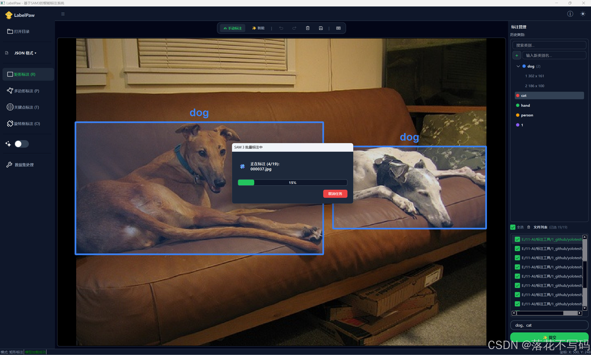 |
| YOLO模型批量标注 | 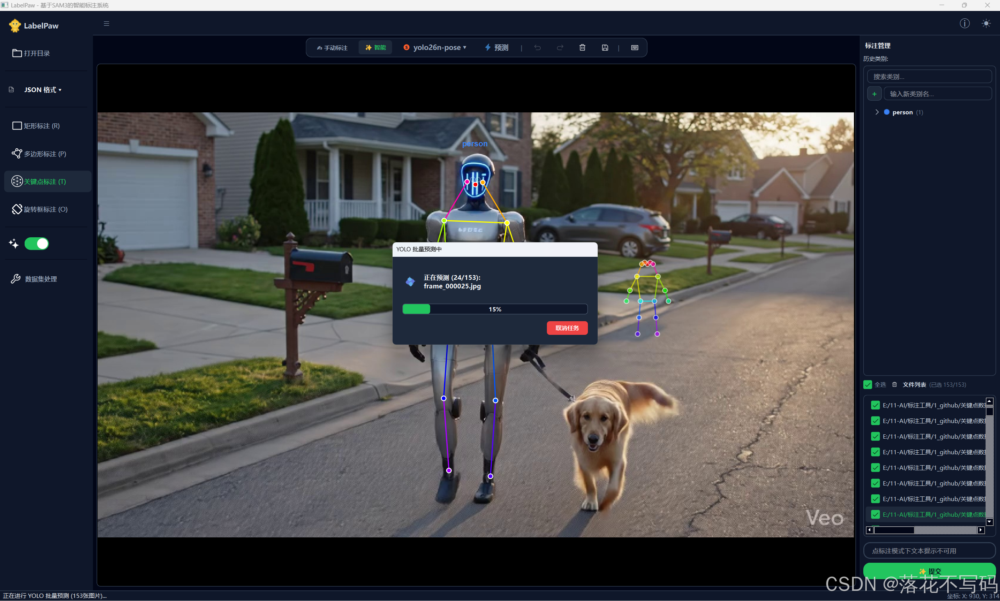 |
| 关键点标注       | 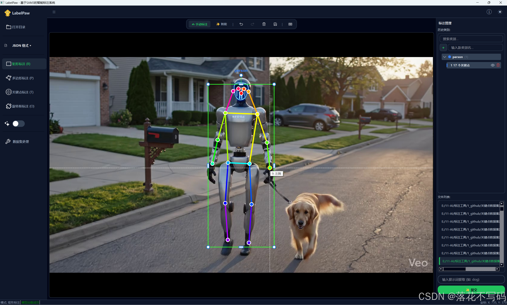 |
| OBB智能标注      | 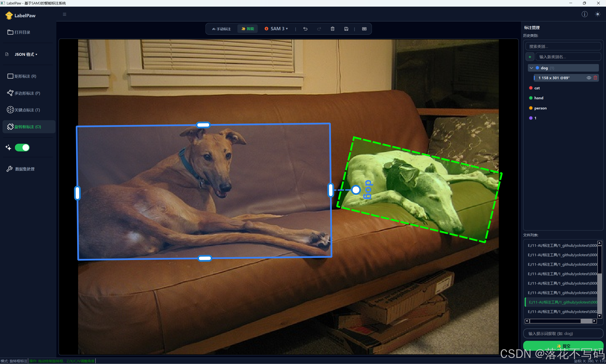 |
| 矩形智能标注     | 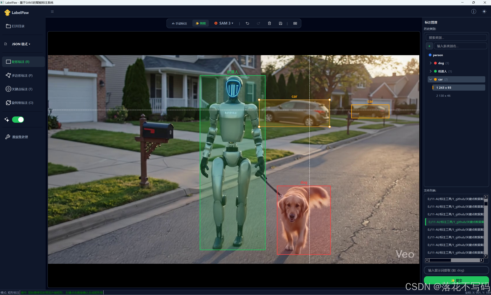 |
| 关键点智能标注   | 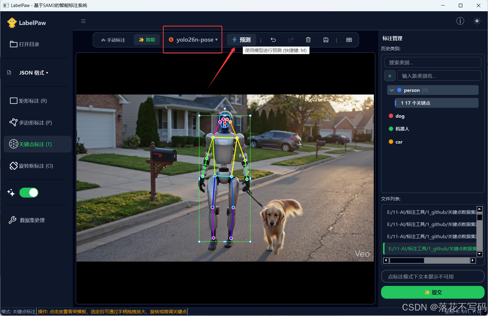 |
| 手部关键点模板 (暗黑) | 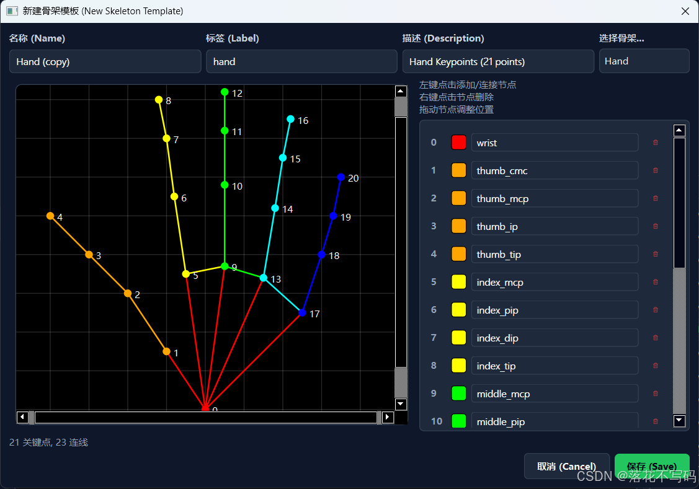 |
| 内置关键点模板   | 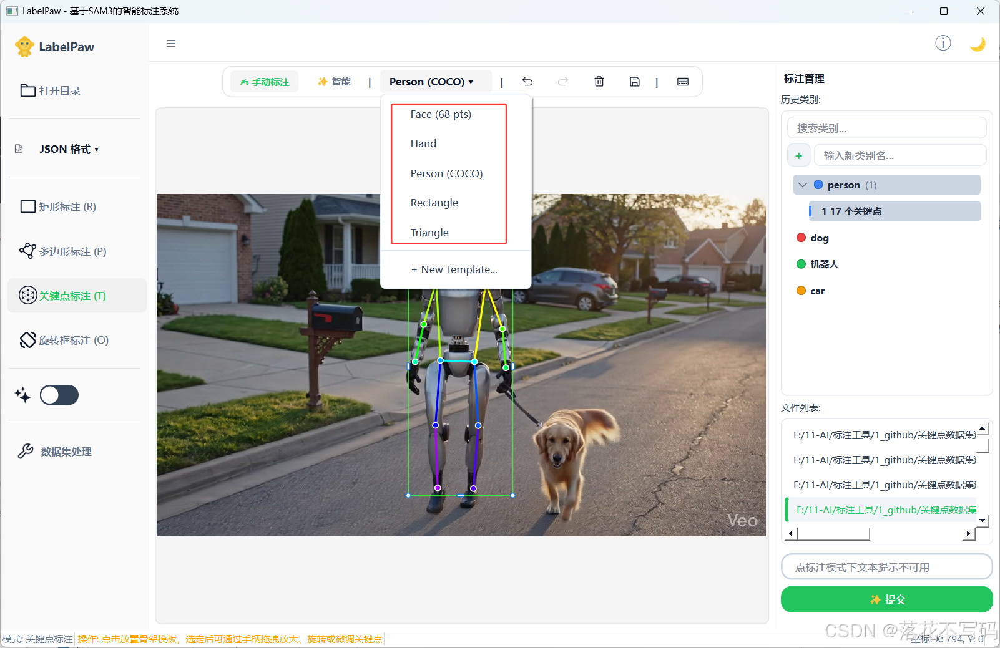 |
| 人脸关键点模板   | 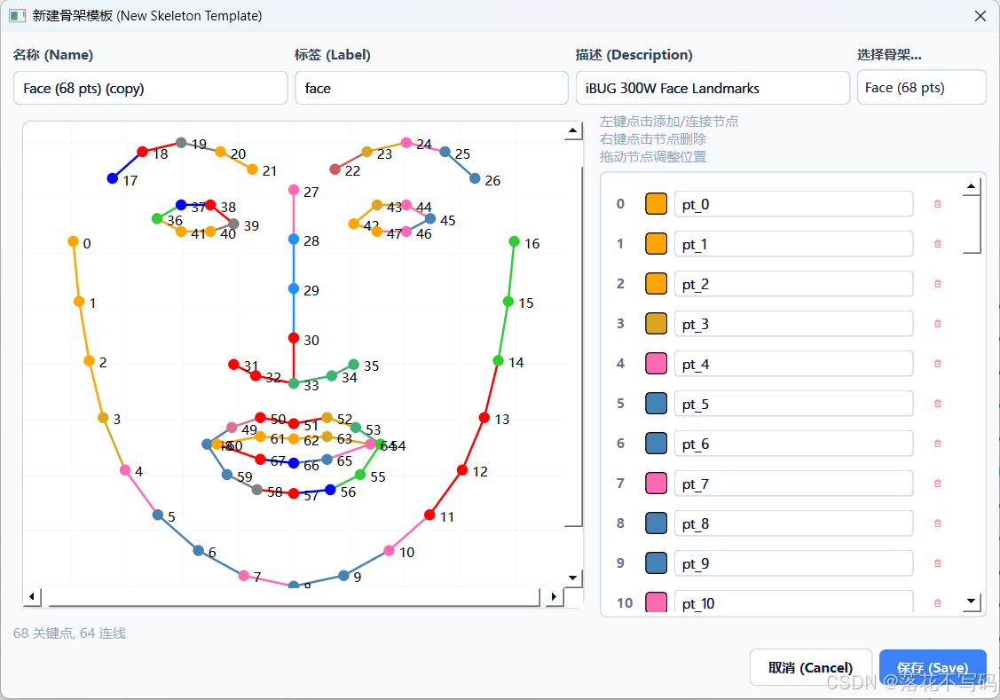 |
| 手部关键点模板 (亮色) | 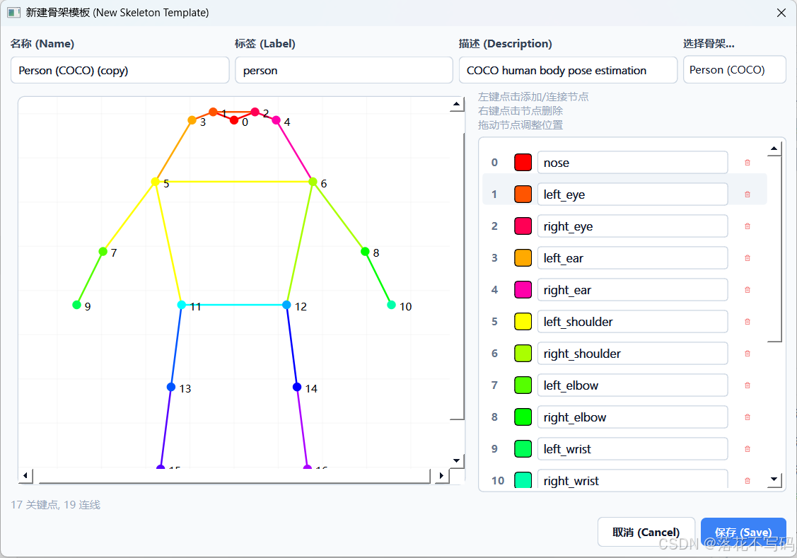 |
| 自定义关键点模板 | 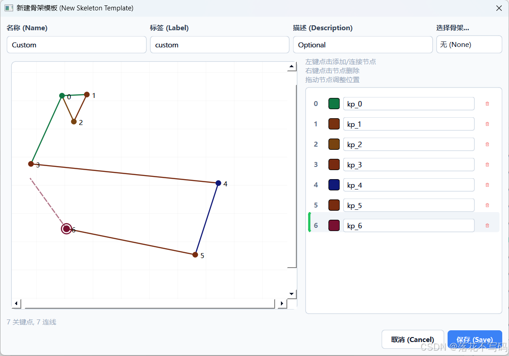 |
| 数据集处理工具   | 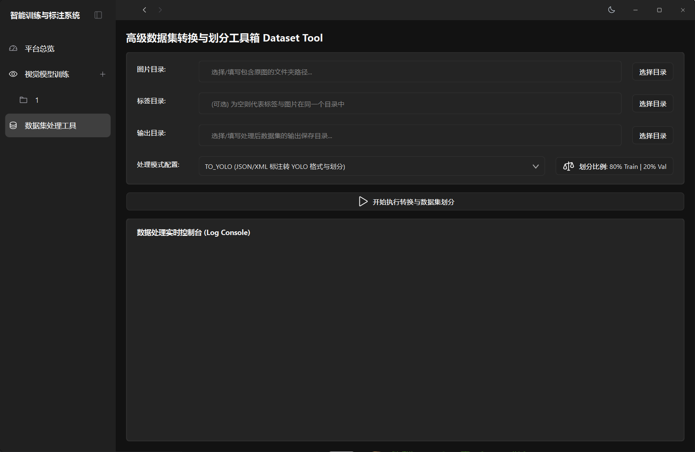 |
| 训练平台总览与硬件监控 |  |
| 项目训练指标与模型对比 |  |
| 创建训练任务与环境探针 |  |
| 实验收敛曲线与学术图表 |  |


## 🙊核心功能特性

- **✨ AI 智能辅助 (SAM2/SAM3 驱动)**：鼠标悬停预览、单点快速提取轮廓、输入文本提示词全图目标自动分割。
- **🦴 关键点骨架模板与智能 (YOLO 驱动)标注**：支持矩形、分割、obb、关键点智能标注，关键点内置行人（17个关键点）、人脸（68个关键点）、手部（21个关键点），关键点标注可自定义骨架模板。
- **🚀 一键式视觉模型训练**：内置集成一键训练平台（TrainingPlatform），支持 YOLO 目标检测、实例分割、姿态估计等模型快速训练，提供学术级多曲线对比看板、实时硬件监控与任务管理。
- **📐 全能标注模式**：矩形 (Rect)、多边形 (Poly)、点 (Point)、OBB 旋转框以及关键点 (Pose)。
- **🔄 极致 OBB 交互**：旋转框控制手柄，360° 无极顺滑旋转与贴墙滑动检测。
- **💾 多格式互转与导出**：原生保存 JSON、YOLO (.txt)、XML (Pascal VOC)，可一键生成 U-Net Mask。
- **🗄️ 数据集处理工作流**：支持按比例切分训练集/验证集/测试集。

---

## 🛠️ 部署与运行环境

### 1. 基础环境依赖

推荐使用 Python 3.10+。

创建虚拟环境，命令如下：

```python
conda create -n py311 python==3.11.5
```
进入刚刚创建的虚拟环境，命令如下：

```python
conda activate py311 
```


首先安装必要的 Python 依赖包：

单独安装 torch>=2.5.0，pytorch 官网地址： [https://pytorch.org/](https://pytorch.org/get-started/previous-versions/?_gl=1*r08hqw*_up*MQ..*_ga*MTg1ODQzMTE5LjE3NzU4ODk5NDI.*_ga_469Y0W5V62*czE3NzU4ODk5NDEkbzEkZzAkdDE3NzU4ODk5NDEkajYwJGwwJGgw/)
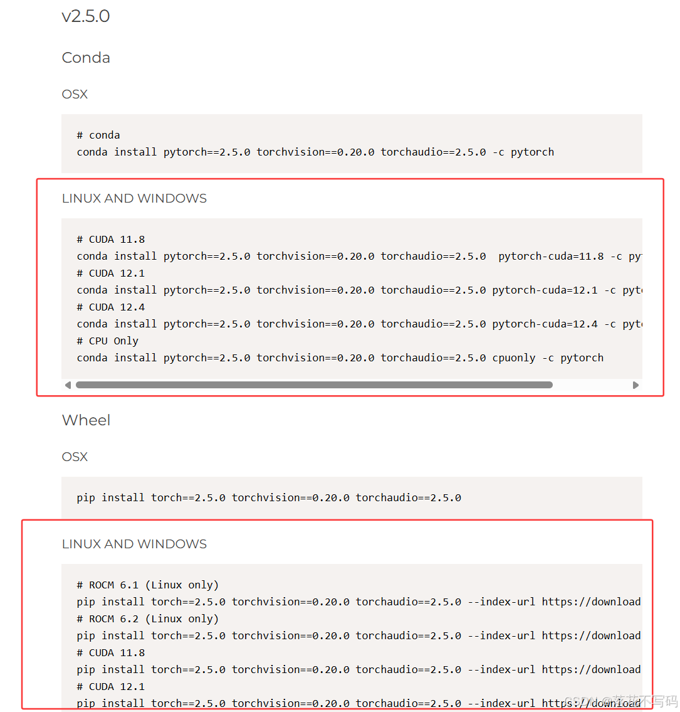

**💡 PyTorch 安装注意事项（新手必看）**

在进行安装 PyTorch 之前，请大家务必核对以下几点，避免安装后运行报错：

**1. 确认显卡支持与 CUDA 版本（极其重要）**
* **适用系统**：本教程基于 Windows 环境。
* **如何查看**：按下 `Win + R` 键，输入 `cmd` 打开命令提示符，输入 `nvidia-smi` 并回车。在弹出的表格右上角，找到 **CUDA Version**。
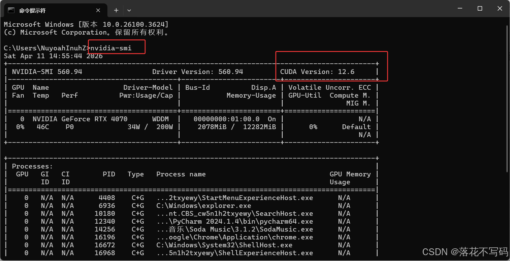

* **版本匹配要求**：你下载的 PyTorch CUDA 版本（例如命令中的 `cu118` 或 `cu116`），**必须小于或等于**你电脑刚刚查到的 CUDA Version。如果你的电脑没有独立 N 卡，或者查不到该信息，请到官网选择 **CPU 版本**的安装命令。


**2. Conda 与 Pip 命令二选一即可**


根据自己电脑安装指定版本，安装命令如下，如果你使用 `conda` 命令卡住，可以尝试先在终端配置好国内的清华/中科大 conda 镜像源，然后再删掉命令后面的 `-c pytorch -c nvidia`（因为带上 `-c` 会强制去国外官方频道下载）：


```bash
conda install pytorch==2.5.0 torchvision==0.20.0 torchaudio==2.5.0  pytorch-cuda=11.8 -c pytorch -c nvidia
```

上面的命令，大多数情况下是安装失败的，所以这里推荐使用阿里云镜像源安装，阿里云上镜像，pytorch gpu版的 whl 包可以在此链接查看：链接: [https://mirrors.aliyun.com/pytorch-wheels](https://mirrors.aliyun.com/pytorch-wheels/)

后面 cu 版本需要对应cuda 的版本号，例如安装 cuda11.8 就写  cu118

```bash
-f  https://mirrors.aliyun.com/pytorch-wheels/cu118
```
cuda11.8 安装命令：
```bash
pip install torch==2.5.0 torchvision==0.20.0 torchaudio==2.5.0 -f  https://mirrors.aliyun.com/pytorch-wheels/cu118
```
cuda12.1 安装命令：

```bash
pip install torch==2.5.0 torchvision==0.20.0 torchaudio==2.5.0 -f  https://mirrors.aliyun.com/pytorch-wheels/cu121
```

**3. 验证是否安装成功**
安装进度条跑完后，不要急着关掉窗口！在终端里输入 `python` ，输入以下代码：
```python
import torch
print(torch.__version__)
print(torch.cuda.is_available())
print(torch.cuda.device_count())
print(f"CUDA：{torch.version.cuda}")
```
如果输出了 `True`，恭喜你，cuda 可用！如果输出 `False`，说明装成了 CPU 版本或者 CUDA 不匹配，可能需要卸载重装。

---


之后在自己的虚拟环境下，使用下面命令安装所需的库

```bash
pip install -r requirements.txt
```
```python
pyside6~=6.4.2
numpy~=1.24.4
opencv-python~=4.11.0.86
pillow~=10.4.0
monkeyqt>=0.2.5
monkeyqt-icons>=2.1.2
einops~=0.8.2
pycocotools~=2.0.11
scipy~=1.15.3
tqdm~=4.67.1
iopath~=0.1.10
matplotlib~=3.10.8
timm~=1.0.26
ftfy~=6.3.1
psutil~=7.2.1
torchmetrics~=1.5.0
omegaconf~=2.3.0
numba~=0.64.0
huggingface-hub~=0.36.2
pandas~=2.3.3
scikit-learn~=1.8.0
setuptools==79.0.1
git+https://github.com/facebookresearch/sam3.git
git+https://github.com/facebookresearch/sam2.git
ultralytics==8.4.49
```

>  **一键训练平台 UI 依赖说明（从旧环境升级必看）**：
> 一键训练平台（TrainingPlatform）基于现代化 PySide6 UI 组件库 **MonkeyQt** 构建。如果您是在旧版 LabelPaw 环境基础上更新，只需在原虚拟环境中补充安装 `monkeyqt` 和 `monkeyqt-icons` 即可直接使用训练平台：
> ```bash
> pip install monkeyqt>=0.2.5 monkeyqt-icons>=2.1.2
> ```
> - **MonkeyQt 组件库使用文档**：[https://monkeyqt.lhbxm.top/](https://monkeyqt.lhbxm.top/)
> - **MonkeyQt 官方源码仓库**：[https://github.com/luohuabuxiema/MonkeyQt](https://github.com/luohuabuxiema/MonkeyQt)

> 注：如果需要使用智能辅助功能，请确保你的环境中已经正确配置了 `sam3`、 `sam2`、`ultralytics`相关的库及其依赖，如果上面的sam3、sam2、ultralytics 库安装失败，下文也有源码方式安装教程。

#### 安装过程我遇到的错误

（1）创建虚拟环境时候创建不了，报错如下：
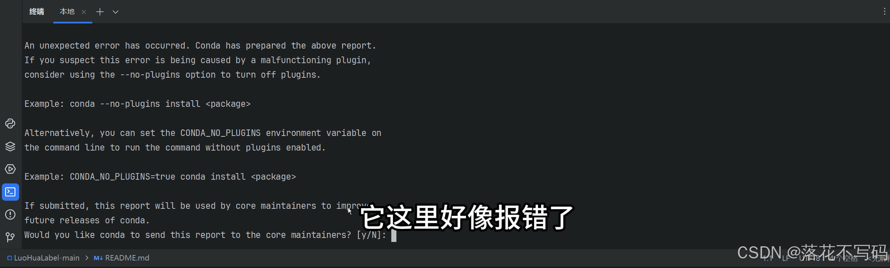

解决方法：去 C:\Users\你的用户下，删除 .condarc 文件 

（2）报错 ModuleNotFoundError: No module named ‘pkg_resources‘ 

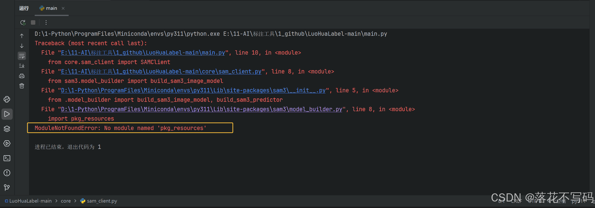

解决方法：降低 setuptools 库版本，我安装的版本是 79.0.1

```python
pip install setuptools==79.0.1
```
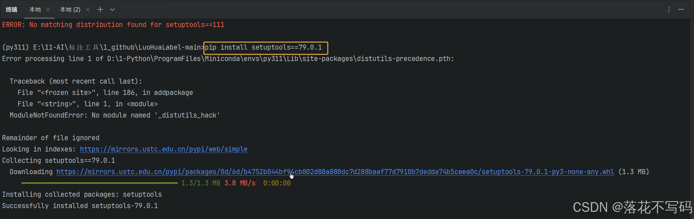

参考链接： [https://blog.csdn.net/u014451778/article/details/158469881](https://blog.csdn.net/u014451778/article/details/158469881/)

（3）报错 ModuleNotFoundError: No module named ‘triton‘ 
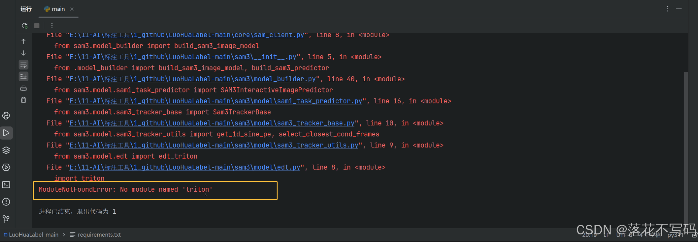

解决方法：下载离线安装包，单独安装

triton离线安装包下载地址：[https://hf-mirror.com/madbuda/triton-windows-builds](https://hf-mirror.com/madbuda/triton-windows-builds/)

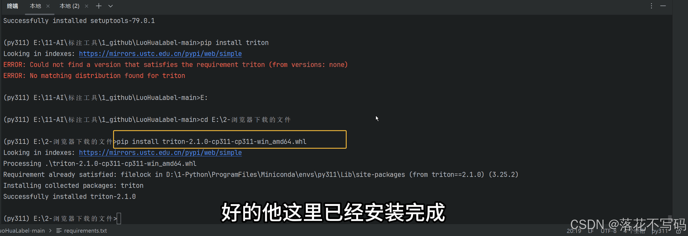

参考链接：[https://blog.csdn.net/qq_42910179/article/details/155606159](https://blog.csdn.net/qq_42910179/article/details/155606159/)

### 2.  sam3、sam2、Ultralytics 源码安装方式

为了确保 SAM2、SAM3、Ultralytics（YOLO） 能够正常工作，你需要去官方仓库下载源码并放置在 `LabelPaw` 根目录下。因为官方库在不断更新，采用源码方式能最大程度保证兼容性。

**官方源码地址**：

- **SAM2**: [https://github.com/facebookresearch/sam2](https://github.com/facebookresearch/sam2)
- **SAM3**: [https://github.com/facebookresearch/sam3](https://github.com/facebookresearch/sam3)
- **Ultralytics (YOLO)**: [https://github.com/ultralytics/ultralytics](https://github.com/ultralytics/ultralytics)

**操作步骤**：

1. 访问上述 GitHub 地址，点击绿色的 **Code** 按钮，选择 **Download ZIP**。
2. 解压下载的压缩包。
3. **重要**：压缩包内往往包含文档、测试用例等很多文件。只需要把解压后里面的**核心代码文件夹**（下载完可以看到有对应名称的 `sam2`、`sam3`、`ultralytics` 文件夹）。
4. 将这三个文件夹（`sam2`, `sam3`, `ultralytics`）直接粘贴到 `LabelPaw` 的根目录下。

**通过命令行直接安装（可选，推荐进阶用户）**：
如果你不想手动下载和复制文件夹，可以直接使用 pip 从 GitHub 源码或 PyPI 进行安装：

```bash
# 安装 SAM2
pip install git+https://github.com/facebookresearch/sam2.git

# 安装 SAM3
pip install git+https://github.com/facebookresearch/sam3.git

# 安装 Ultralytics
pip install ultralytics
```

> ⚠️ **`git+` 安装方式注意事项**：
> 1. **需安装 Git**：你的电脑必须提前安装并配置好 [Git](https://git-scm.com/) 环境，否则命令会直接报错。
> 2. **国内网络问题**：由于 GitHub 在国内部分地区访问不稳定，使用 `git+https://...` 时容易遇到 `Time out` 或连接失败。国内用户建议：
>    - 开启科学上网环境，并在命令行中临时设置 Git 代理。
>    - 或者优先推荐使用上方的**官方源码下载解压**方式，这种方式最稳妥。

### 3. 模型下载与配置修改

**模型下载与存放说明**：

为了启用智能标注，你需要下载相应的权重文件 (`.pt`) 并按照规范的目录结构组织。

**1. 推荐的模型存放目录结构**
建议按照以下结构在本地整理您的模型文件：
```text
 weights/
      ├── sam_weights/          <-- 存放所有 SAM 系列模型 (必须叫这个名字)
      │    ├── sam3.pt
      │    ├── sam2.1_hiera_tiny.pt
      │    └── ...
      ├── yolo26_weights/       <-- 存放 YOLO26 系列模型
      │    ├── yolo26n-pose.pt
      │    └── ...
      ├── yolov8_weights/       <-- 您也可以自己新建其他 YOLO 版本的文件夹
      │    ├── yolov8n.pt
      │    └── ...
      └── ...
```

**2. SAM 系列模型下载与存放**

- **SAM 3 模型 (3.5 GB)**：前往官方 GitHub 仓库或 HuggingFace 搜索 `sam3` 获取。存放在 `\weights\sam_weights\sam3.pt`。
- **SAM 2.1 模型**：
  - SAM 2.1 Tiny : [https://dl.fbaipublicfiles.com/segment_anything_2/092824/sam2.1_hiera_tiny.pt](https://dl.fbaipublicfiles.com/segment_anything_2/092824/sam2.1_hiera_tiny.pt)
  - SAM 2.1 Small: [https://dl.fbaipublicfiles.com/segment_anything_2/092824/sam2.1_hiera_small.pt](https://dl.fbaipublicfiles.com/segment_anything_2/092824/sam2.1_hiera_small.pt)
  - SAM 2.1 Base: [https://dl.fbaipublicfiles.com/segment_anything_2/092824/sam2.1_hiera_base_plus.pt](https://dl.fbaipublicfiles.com/segment_anything_2/092824/sam2.1_hiera_base_plus.pt)
  - SAM 2.1 Large: [https://dl.fbaipublicfiles.com/segment_anything_2/092824/sam2.1_hiera_large.pt](https://dl.fbaipublicfiles.com/segment_anything_2/092824/sam2.1_hiera_large.pt)
  - 存放位置：`\weights\sam_weights\` 目录下 (文件名请保持默认)。

**3. YOLO 系列模型下载与存放**
- **YOLO 模型**：可前往 YOLO 官方 GitHub 或对应框架页面下载最新权重（如 yolov8、yolo11、yolo26 等）。姿态估计推荐下载带 `-pose` 后缀的模型（如 `yolo26n-pose.pt`）。
- **存放位置**：存放在对应的文件夹内，如 `\weights\yolo26_weights\`。*(注：您也可以将自己训练好的 YOLO 模型放入对应文件夹中，软件可自动读取！)*

**模型路径修改说明**：
为了让系统找到你下载的模型，

>方法1：在项目根目录下新建一个 weights 文件夹，存放模型，模型存放结构看上文介绍

>方法2：在其他地方新建一个 weights 文件夹，存放模型，模型存放结构看上文介绍，**只需**修改代码中的一个基础路径变量：
打开 `main.py`、`labelpaw/models/sam_client.py` 以及 `ui/model_selector_dialog.py`，找到里面的 `HARDCODED_DEV_DIR` 变量，将其统一修改为您本地 `weights` 文件夹的绝对路径： **HARDCODED_DEV_DIR= r"你的绝对路径\weights"**


*(注：系统会自动扫描该目录下所有形如 `yolo*_weights` 的子文件夹并加载 YOLO 模型，因此你只需放好模型，无需再手动指定 YOLO 的子目录！)*

**【特别说明：无显卡(GPU)用户的建议】**
如果您的电脑没有独立显卡（GPU）或者配置较低，强烈建议您优先使用 YOLO 系列模型（如带有 "n" 或 "s" 的轻量级模型）。SAM 系列模型即使是 tiny 版本也相对较重，在纯 CPU 环境下运行可能会非常卡顿或导致软件未响应，而 YOLO 轻量级模型在 CPU 上也能保持不错的处理速度。

### 4. 启动系统

完成所有配置后，可在根目录下按需启动：

- **主系统（智能图像标注与训练平台一体化入口）**：
```bash
python main.py
```
*(可在标注界面左侧工具栏一键唤起模型训练平台)*

- **独立运行一键训练平台（TrainingPlatform）**：
```bash
python TrainingPlatform/main_app.py
```

---

## 📖 用户操作指南

### 1. 智能图像标注工作流 (LabelPaw)

#### 📋 基本标注操作流程
1. **打开目录**：点击左侧“打开目录”按钮选择图片所在文件夹。
2. **选择保存格式**：在左侧下拉菜单选择保存格式（支持 `JSON` / `YOLO` / `XML`）。
3. **选择标注模式**：在左侧工具栏选择标注模式，支持矩形、多边形、点、OBB 旋转框以及关键点骨架。
4. **智能辅助标注**：开启 **智能辅助**（快捷键 `Q`）。
   - **SAM2 / SAM3 模型**：支持鼠标悬停实时轮廓预览、单点快速提取目标边界；SAM3 支持输入文本提示词（如 "car", "dog"）进行全图自动分割。
   - **YOLO 模型**：支持在顶部工具栏切换并执行目标检测、分割、旋转框及姿态估计的自动预推理。
5. **关键点/骨架模板**：进入关键点模式后，可在顶部栏选择内置模板（人体 17 点、人脸 68 点、手部 21 点），亦可自定义关键点模板骨架连线。
6. **数据集处理**：点击工具栏的“数据集转换”，可执行 JSON / XML / YOLO 格式互转、一键生成 U-Net 二值掩膜（Mask），以及自定义比例随机划分训练集/验证集/测试集。

#### ⌨️ 标注快捷键大全

| 快捷键 | 功能说明 | 快捷键 | 功能说明 |
| :--- | :--- | :--- | :--- |
| **A / ←** | 切换至上一张图片 | **D / →** | 切换至下一张图片 |
| **Ctrl + S** | 手动保存当前图片标注 | **Q** | 开启 / 关闭 SAM 智能辅助 |
| **R** | 切换为矩形标注模式 (Rect) | **P** | 切换为多边形标注模式 (Poly) |
| **O** | 切换为旋转框标注模式 (OBB) | **T** | 切换为关键点标注模式 (Pose) |
| **M** | 触发 YOLO 模型智能推理 | **E** | 快速修改当前选中目标的类别 |
| **Del / Backspace** | 删除当前选中的标注目标 | **Ctrl + Z** | 撤销上一步操作 (支持 20 步) |
| **Ctrl + Y** | 重做操作 (Ctrl+Shift+Z) | **Z / X / C / V** | OBB 旋转框高精度角度微调 |

---

### 2. 一键视觉模型训练平台使用教程 (TrainingPlatform)

一键训练平台（TrainingPlatform）基于现代 UI 组件库 MonkeyQt 构建，旨在帮助用户无需繁琐编写代码即可完成深度学习视觉模型的全流程一键式训练、实时监控与导出。

#### 🛠️ 2.1 训练前准备事项

在开始训练前，请确保完成以下准备工作：

##### 1. 数据集准备与标准目录结构
使用 LabelPaw 标注完成后，通过工具栏的 **“数据集转换”** 功能将标注导出并划分为标准的 YOLO 格式目录：
```text
my_dataset/
├── images/
│   ├── train/          <-- 训练集图片 (.jpg, .png 等)
│   ├── val/            <-- 验证集图片
│   └── test/           <-- 测试集图片 (可选)
└── labels/
    ├── train/          <-- 训练集对应标注文件 (.txt)
    ├── val/            <-- 验证集对应标注文件 (.txt)
    └── test/           <-- 测试集对应标注文件 (可选)
```

##### 2. 编写/配置 `data.yaml` 文件
在数据集根目录下创建 `data.yaml`（平台内自带在线编辑器，可直接加载修改）：

- **常规任务（目标检测 / 实例分割 / 旋转框 OBB）**：
```yaml
# 训练集与验证集路径 (支持绝对路径或相对于项目根目录的相对路径)
train: D:/datasets/my_dataset/images/train
val: D:/datasets/my_dataset/images/val
test: # D:/datasets/my_dataset/images/test (可选)

# 类别数量
nc: 2

# 类别名称映射
names:
  0: dog
  1: cat
```

- **关键点 / 姿态估计任务 (Pose)**：
```yaml
train: D:/datasets/my_pose_dataset/images/train
val: D:/datasets/my_pose_dataset/images/val

nc: 1
names:
  0: person

# 关键点维度：[关键点数量, 坐标维度(x, y, visible)]
kpt_shape: [17, 3]
# 水平翻转增强时的对称关键点索引映射
flip_idx: [0, 2, 1, 4, 3, 6, 5, 8, 7, 10, 9, 12, 11, 14, 13, 16, 15]
```

##### 3. 基础预训练模型准备
- 平台支持 YOLOv8、YOLO11、YOLO26 等系列模型。
- 可选择使用官方预训练权重（如 `yolov8n.pt`, `yolo11s.pt`, `yolo26n-seg.pt`, `yolo26n-pose.pt`）。若本地未下载，启动训练时将自动下载，或手动放置于本地后在平台中点击“浏览”选取。

##### 4. 硬件环境要求
- **独立显卡 (推荐)**：配备 NVIDIA 显卡并安装好支持 CUDA 的 PyTorch。平台自带**环境探针**，启动时自动检测 GPU 型号、显存大小（如 RTX 4090 24GB）及 CUDA 状态。
- **无显卡用户**：平台支持选择 **CPU 训练**，建议搭配轻量级模型（如 `yolov8n`、`yolo11n`）并将 `batch` 设为小数值。

---

#### 🚀 2.2 详细训练操作步骤

##### 第一步：启动训练平台
- **集成入口**：启动 LabelPaw（`python main.py`），在主界面左侧导航栏点击 **“模型训练”** 图标即可直接拉起。
- **独立入口**：在终端直接运行 `python TrainingPlatform/main_app.py`。

##### 第二步：新建或选择训练项目 (Project)
1. 首次进入后，在左侧导航进入 **“项目管理”** 页面。
2. 点击右上角 **“新建项目”**，输入项目名称（如 `Road_Defect_Inspection`），选择视觉任务类型（目标检测 Detect / 实例分割 Segment / 姿态估计 Pose / 旋转框 OBB），点击确定。
3. 点击进入创建好的项目详情页。

##### 第三步：配置训练任务超参数 (Train Configuration)
在项目详情页中点击右上角 **“新建训练任务”**，系统将弹出全功能参数配置窗口：

1. **基础配置 (模型与数据)**：
   - **基础模型**：选择内置预设模型（如 YOLOv8n / YOLO11s）或点击文件夹图标加载本地自定义 `.pt` 权重。
   - **数据集配置**：点击“选择数据集”选取前面准备好的 `data.yaml`。窗口右侧将自动加载 YAML 内容，并支持直接在线编辑与保存。
2. **核心训练超参数**：
   - **训练轮数 (Epochs)**：根据数据集大小设定，通常建议 `100` ~ `300` 轮。
   - **批次大小 (Batch Size)**：支持填入 `auto`（平台自动根据当前显存探测最优批次），也可手动填入 `8`、`16`、`32` 等固定数值。
   - **图像尺寸 (ImgSz)**：默认 `640`，小目标较多或高分辨率图像可设为 `1280`。
   - **实验任务名称**：为本次训练命名（如 `exp1_baseline`）。
3. **高级超参数微调 (可折叠面板)**：
   - **优化器与学习率**：支持选择 `auto`、`SGD`、`Adam`、`AdamW`，可配置初始学习率 `lr0`（默认 0.01）、余弦退火学习率 `cos_lr`、学习率预热轮数 `warmup_epochs`。
   - **加速与训练策略**：
     - **自动混合精度 (AMP)**：默认开启，大幅降低显存占用并提升训练速度；
     - **早停机制 (Patience)**：当指标连续 N 轮无改善时自动停止（默认 100）；
     - **关闭增强 (Close Mosaic)**：最后 N 轮自动关闭 Mosaic 增强以稳定模型收敛（默认 10）；
     - **断点续训 (Resume)**：若此前训练意外中断，勾选此项并指定 `last.pt` 即可无缝续训。
   - **数据增强控制**：可微调 Mosaic、Mixup、HSV 抖动、旋转 (Degrees)、水平/垂直翻转比例等。
4. **硬件与训练设备探针**：
   - 在底部的训练设备选择栏中，平台已自动探测到可用显卡（如 `0: NVIDIA GeForce RTX 4090`）。勾选目标 GPU 编号，并指定数据读取进程数（`workers`，推荐设为 4 或 8）。

##### 第四步：启动训练与实时动态监控
1. 确认参数无误后，点击窗口右下角 **“开始训练”**。
2. 任务自动进入后台执行，界面无缝切换至 **“实时监控”** 看板：
   - **学术级多指标收敛曲线**：实时动态绘制当前 Epoch 的各项指标：
     - **损失曲线 (Loss)**：`train/box_loss`、`train/cls_loss`、`train/dfl_loss` 及验证集 Loss；
     - **学术评测指标**：`metrics/precision(B)`、`metrics/recall(B)`、`metrics/mAP50(B)`、`metrics/mAP50-95(B)`；
     - 支持曲线平滑滤波切换、单曲线聚焦查看及多实验曲线对比。
   - **美化日志控制台**：实时格式化输出训练进度条、显存占用量 (VRAM)、耗时估算与学习率。
   - **硬件探针监控卡片**：实时动态显示显存使用量、显存利用率及系统 CPU 负载。

##### 第五步：实验评估与模型导出
1. 训练完成后，平台将自动汇总本次训练的所有学术图表：
   - 混淆矩阵图 (`confusion_matrix.png`)
   - PR 曲线图 (`PR_curve.png`) 与 F1-Confidence 曲线图
   - 验证集真实标注与模型预测效果对比图 (`val_batch_pred.jpg`)
2. **权重文件自动归档**：
   - `best.pt`：验证集指标最高的最佳模型权重；
   - `last.pt`：最终轮次检查点权重（用于断点续训）。
3. **工业模型导出**：
   - 在实验详情页面点击 **“模型导出”**，可一键将 `best.pt` 转换为 **ONNX**、**TensorRT (Engine)**、**TorchScript** 等格式，便于后续在边缘设备或生产环境高性能部署。

---

#### 🔄 2.3 “标注-训练”生态无缝闭环

在 LabelPaw 中，标注与训练并非割裂的两个工具，而是紧密集成的闭环流程：
```text
┌─────────────────┐      数据集导出 (YOLO格式)     ┌──────────────────────┐
│  LabelPaw       │ ───────────────────────────> │  TrainingPlatform    │
│  智能图像标注   │                              │  一键视觉模型训练    │
└─────────────────┘                              └──────────────────────┘
        ▲                                                   │
        │           导入生成的 best.pt 权重                  │
        └───────────────────────────────────────────────────┘
```
1. 使用 LabelPaw 标注少量样本（如 100~200 张）并导出数据集；
2. 在 TrainingPlatform 中一键训练，产出属于您自己场景的 `best.pt`；
3. 将 `best.pt` 放入 LabelPaw 的 `weights/` 目录下；
4. 回到 LabelPaw 标注界面，顶部选择该模型并开启 **智能辅助**，即可使用自己训练的模型对后续成千上万张待标图片进行**全自动批量预标注**，标注效率提升 10 倍以上！

---

#### 💡 2.4 训练常见问题与调优技巧 (FAQ)

- **Q1: 训练启动后报错显存不足 (CUDA Out of Memory / OOM)？**
  - **解决方法**：
    1. 在新建任务时将 `批次大小 (Batch Size)` 调小（例如从 32 改为 16、8 或 4）；
    2. 将 `图像尺寸 (ImgSz)` 适度降低（如从 1280 降为 640 或 480）；
    3. 确认已开启高级设置中的 `AMP (自动混合精度)`；
    4. 调小 `工作线程数 (workers)`（设为 2 或 4）。
- **Q2: 电脑没有独立 GPU 可以训练吗？**
  - **解决方法**：可以。在训练设备中选择 `CPU`，并选用轻量级的 `yolov8n` 模型，将 `batch` 设为 4，`epochs` 设为较小轮数进行初步验证。
- **Q3: 训练意外中断，如何恢复？**
  - **解决方法**：进入新建训练任务窗口，勾选高级设置中的 **“断点续训 (Resume)”**，在基础模型路径中选择此前中断实验输出的 `last.pt` 权重文件，点击开始训练即可从中断的轮次无缝继续。

---

## 🤝 欢迎二次开发 

系统采用模块化设计，高内聚低耦合，前端 UI 与底层模型推理分离。
- `main.py`：主控界面与事件路由。
- `labelpaw/`：图像标注核心模块，包含绘图画布 (`graphics/canvas.py`)、数据格式导出 (`data/exporter.py`)、SAM 智能模型推理 (`models/sam_client.py`) 以及 YOLO 智能模型推理 (`models/yolo_predictor.py`)。
- `TrainingPlatform/`：一键视觉模型训练平台模块，基于 MonkeyQt 组件库构建，包含训练任务调度器 (`core/`)、现代 UI 视图与学术图表 (`ui/`) 等。
- `ui/`：图形化组件与主题定制。

欢迎广大开发者 Fork 并提交 PR！

## 声明

本项目已采用 GPL-3.0 协议，如果您在商业或非商业项目中使用了本代码，请遵守该协议开源您的衍生修改版本。感谢大家的支持，有帮助的话可以给仓库点个 Star！

## 引用

如果您在研究中使用该软件，请引用如下：

```bibtex
@misc{LabelPaw,
  year = {2026},
  author = {luohuabuxiema},
  publisher = {Github},
  journal = {Github repository},
  title = {LabelPaw: Intelligent image annotation system},
  howpublished = {\url{https://github.com/luohuabuxiema/LabelPaw}}
}
```

**致谢与参考模型引用**：

```bibtex
@misc{carion2025sam3segmentconcepts,
      title={SAM 3: Segment Anything with Concepts},
      author={Nicolas Carion et al.},
      year={2025},
      eprint={2511.16719},
      archivePrefix={arXiv},
      primaryClass={cs.CV},
      url={https://arxiv.org/abs/2511.16719},
}

@article{ravi2024sam2,
  title={SAM 2: Segment Anything in Images and Videos},
  author={Ravi, Nikhila and Gabeur, Valentin and Hu, Yuan-Ting and Hu, Ronghang and Ryali, Chaitanya and Ma, Tengyu and Khedr, Haitham and R{\"a}dle, Roman and Rolland, Chloe and Gustafson, Laura and others},
  journal={arXiv preprint arXiv:2408.00714},
  year={2024}
}

@software{ultralytics,
  author = {Glenn Jocher and Ayush Chaurasia and Jing Qiu},
  title = {Ultralytics},
  year = {2023},
  url = {https://github.com/ultralytics/ultralytics},
  license = {AGPL-3.0}
}
```
